<p align="center">
  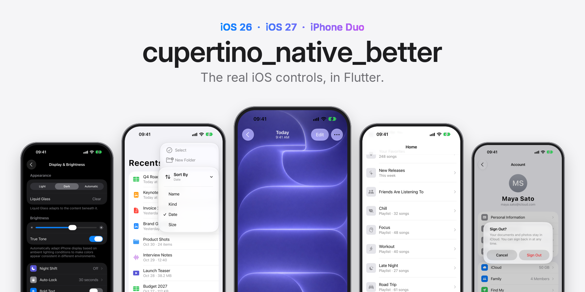
</p>

<p align="center">
  <strong>The real iOS&nbsp;26 and iOS&nbsp;27 controls, in Flutter.</strong><br>
  Liquid Glass tab bars, buttons, menus, date pickers, sliders, switches, alerts and sheets, drawn by UIKit and SwiftUI themselves.
</p>

<p align="center">
  <a href="https://pub.dev/packages/cupertino_native_better"></a>
  <a href="https://pub.dev/packages/cupertino_native_better/score"></a>
  <a href="https://github.com/gunumdogdu/cupertino_native_better/blob/main/LICENSE"></a>
  <a href="https://gunumdogdu.com/docs"></a>
</p>

<p align="center">
  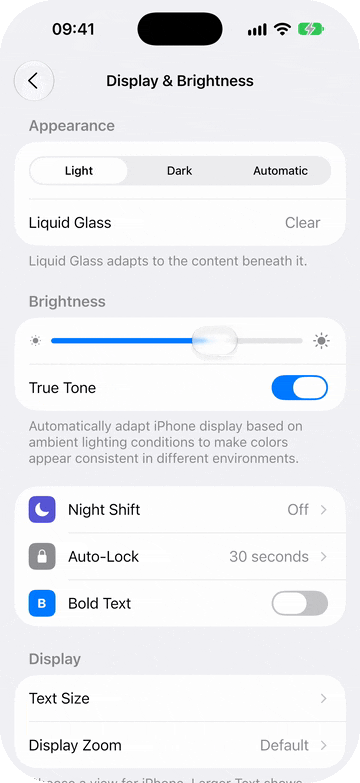
  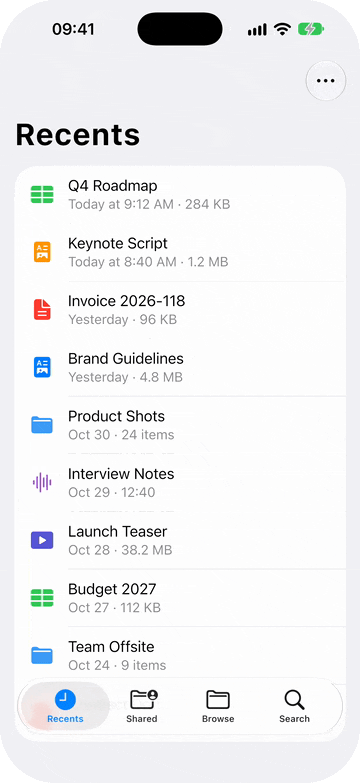
  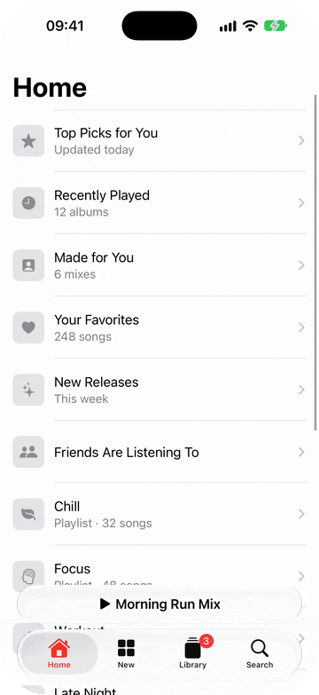
</p>

<p align="center">
  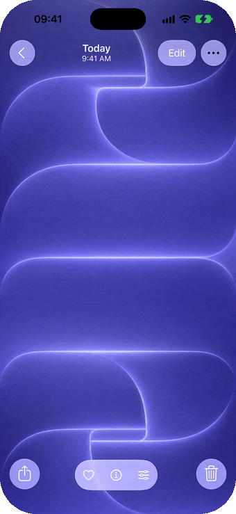
  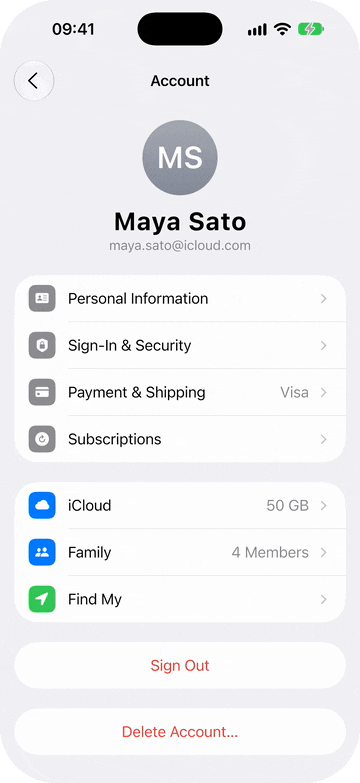
</p>

<p align="center"><sub>Every screen on this page is the example app, recorded on the iOS&nbsp;27 simulator. Nothing is mocked up.</sub></p>

## Why it looks right

- **Apple's own controls.** Each widget is a native UIKit or SwiftUI view, so the Liquid Glass, the animations, the menus and the haptics are the system's, and they keep up with every iOS release.
- **Liquid Glass everywhere it belongs.** Tab bars that minimize on scroll, glass buttons and button groups that blend, slider thumbs that turn to glass under your finger, menus with submenus, alerts and anchored action sheets.
- **iPhone Duo ready.** Tabs move to the vertical bar when folded and to a sidebar when open, and layouts can split at the hinge.
- **Light and dark for free.** Every control follows the app's brightness.
- **At home on the Mac.** On macOS the same widgets are AppKit's own buttons, sliders, menus, alert sheets and search fields, from macOS&nbsp;12.
- **Runs everywhere else, too.** Below iOS&nbsp;26 and on Android and the web, each widget falls back to its Cupertino counterpart, so one codebase covers every platform.
- **Accessible.** Native controls carry their VoiceOver names, values and traits.

<p align="center">
  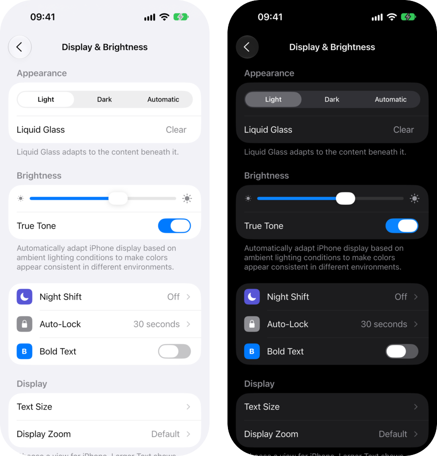
</p>

## What's new in 2.3

<p align="center">
  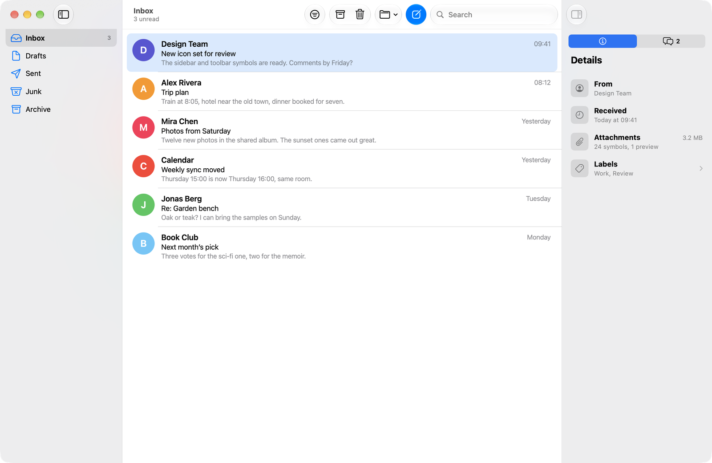
</p>

<p align="center">
  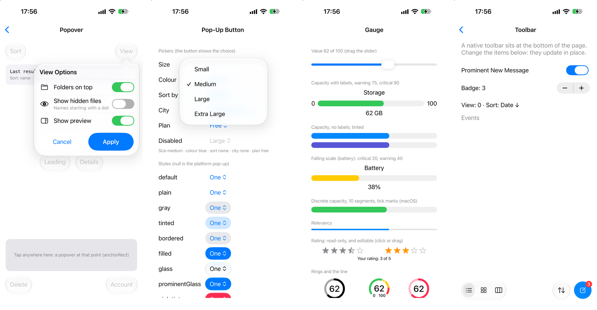
</p>

- **The Mac window goes native.** On macOS, `CNTabBarNative` becomes the window's sidebar, `CNNativeSheet` its inspector, and the new `CNToolbar` its toolbar, around your unchanged Flutter content. See [Mac window](#mac-window-sidebar-toolbar-and-inspector).
- **`CNPopover`:** a native popover pointing at a widget, on iPhone, iPad and Mac. See [Popover](#popover).
- **`CNPopUpButton`:** the pop-up button that picks one value and shows it. See [Pop-up button](#pop-up-button).
- **`CNGauge`:** gauges and level indicators, with warning and critical zones and an editable rating. See [Gauge](#gauge).
- **`CNToolbar`:** the window toolbar on macOS, a Liquid Glass bottom toolbar on iOS. See [Toolbar](#toolbar).
- **`CNSidebar`:** a native sidebar list for your own layout; `CNTabRail` and `CNTabScaffold` use it on macOS.
- **Fixed:** #120 (`CNSegmentedControl` press-and-drag), `CNTabBarNative` left on screen when its page was popped in code, the empty tab bar of `CNSearchScaffold` on iOS.

## What's new in 2.2

<p align="center">
  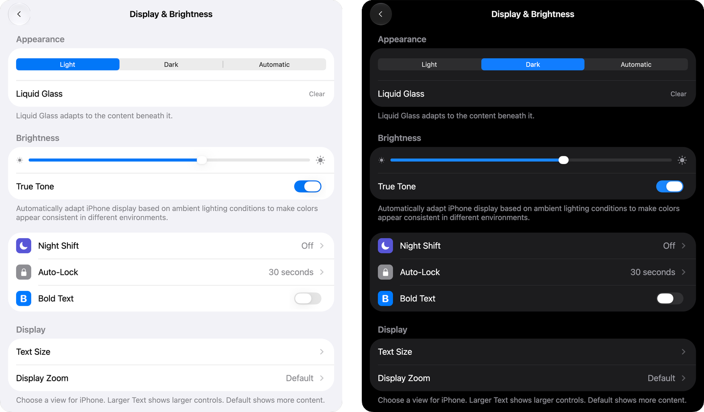
</p>

<p align="center">
  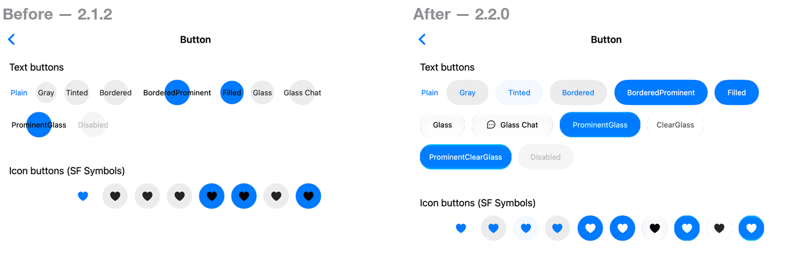
</p>

- **Native controls on every macOS.** Buttons, pop-up buttons, sliders, switches, steppers, date pickers, colour wells, segmented controls and the tab bar use their AppKit controls on macOS&nbsp;12 and later, not only on macOS&nbsp;26. The Liquid Glass styles still need macOS&nbsp;26. See [macOS](#macos).
- **macOS dialogs, menus and search.** `CNAlert` is an `NSAlert` sheet on the window, `CNActionSheet` a menu that drops down from its anchor, and `CNSearchBar` an `NSSearchField` that can keep recent searches.
- **Images on macOS.** Image assets, image bytes, SVGs and custom icons draw in `CNIcon`, `CNButton`, `CNPopupMenuButton`, `CNTabBar` and `CNGlassButtonGroup`.
- **#47 fixed:** a macOS app no longer hangs with a debugger attached.
- **`CNContextMenu`:** a native context menu for any widget. Right-click on macOS, long press on iOS. See [Context menu](#context-menu).
- **`CNProgressIndicator`:** a native progress bar or spinner, with a value or without one. See [Progress indicator](#progress-indicator).

## What's new in 2.1

<p align="center">
  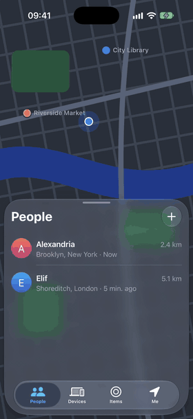
</p>

- **`CNNativeSheet`:** a native sheet over your Flutter app, the kind a map app keeps open. It rests at a few heights, the screen behind it stays usable, and with more than one page it holds a native tab bar. At `CNSheetDetent.collapsed` it shrinks to a glass capsule that holds only the tab bar, as Find My's does. See [Native sheet](#native-sheet).
- **`CNListItem.leadingImage` and `trailingText`,** for a photo and a value such as a distance.

## What's new in 2.0

<p align="center">
  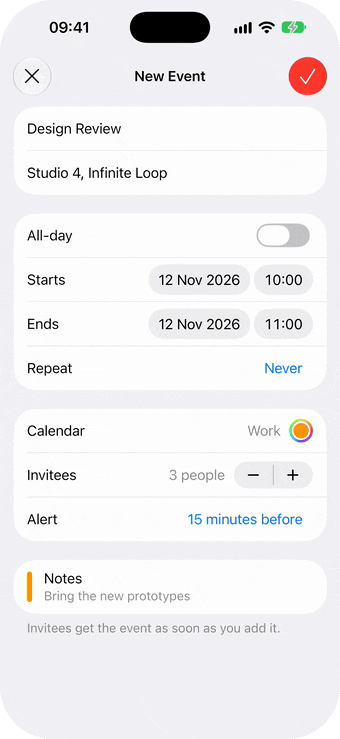
  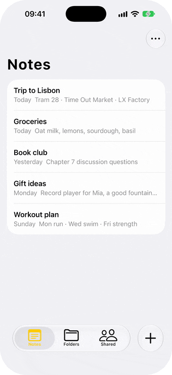
  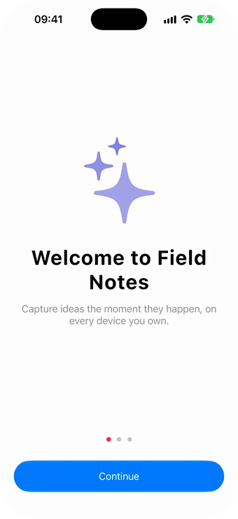
  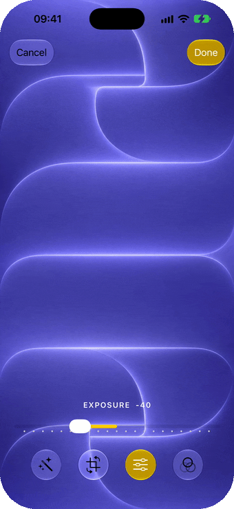
</p>

- **Four new native controls:** `CNDatePicker` (compact, inline and wheels), `CNStepper`, `CNColorWell`, which opens the system colour picker, and `CNPageControl`, which follows a `PageView`.
- **SF Symbol effects on `CNIcon`:** bounce, pulse, variable colour, wiggle, breathe, rotate, draw on and off, and animated symbol replacement.
- **Clear glass buttons** for controls over photos and video, and **`CNSlider` without a thumb, with tick marks**, or filling from a middle value.
- **Tab bar items that open a menu**, such as a "+" that asks what to create. Thanks [@johan-perso](https://github.com/johan-perso).
- **Palettes, inline sections and items that keep the menu open** in `CNPopupMenuButton` and in tab menus.
- **The iOS&nbsp;27 prominent tab** in `CNTabBarNative`.

2.0 removes three APIs deprecated since 1.3 and 1.5, and adds two `CNButtonStyle` values. If you used `PlatformVersion.initialize()`, `CNTabBarNative.checkIsEnabled()` or the old `CNTabBarNative` search callbacks, or `switch` over `CNButtonStyle`, see [Breaking changes](https://pub.dev/packages/cupertino_native_better/changelog#200). The full list is in the [changelog](https://pub.dev/packages/cupertino_native_better/changelog).

## Installation

```yaml
dependencies:
  cupertino_native_better: ^2.3.0
```

The deployment targets are iOS&nbsp;15.0 and macOS&nbsp;12.0. Liquid Glass needs iOS&nbsp;26 or macOS&nbsp;26. Below iOS&nbsp;26 the widgets fall back to Cupertino widgets; on macOS they stay AppKit controls on every version. See [Platform Fallbacks](#platform-fallbacks).

## Quick start

```dart
import 'package:cupertino_native_better/cupertino_native_better.dart';
import 'package:flutter/cupertino.dart';

void main() => runApp(
  CupertinoApp(
    // Keeps Liquid Glass views below sheets and dialogs. Required.
    navigatorObservers: [CNTabBarRouteObserver()],
    home: const HomePage(),
  ),
);

class HomePage extends StatefulWidget {
  const HomePage({super.key});

  @override
  State<HomePage> createState() => _HomePageState();
}

class _HomePageState extends State<HomePage> {
  bool _wifi = true;

  @override
  Widget build(BuildContext context) {
    return CupertinoPageScaffold(
      child: Center(
        child: Column(
          mainAxisSize: MainAxisSize.min,
          children: [
            CNButton(
              label: 'Get Started',
              config: const CNButtonConfig(style: CNButtonStyle.prominentGlass),
              onPressed: () {},
            ),
            CNSwitch(value: _wifi, onChanged: (v) => setState(() => _wifi = v)),
          ],
        ),
      ),
    );
  }
}
```

### Required Setup: register `CNTabBarRouteObserver`

iOS 26 Liquid Glass widgets are native `UIView`s composited under Flutter via hybrid composition. Without coordination, their drop shadow / soft-edge halo can bleed through any sheet or popup pushed over the page, and `CNTabBar` can render above modal content (e.g. making a `TextField` inside a sheet invisible).

`cupertino_native_better` ships a single `NavigatorObserver` that fixes this for the entire app. **Register it once** on your root navigator:

```dart
CupertinoApp(
  navigatorObservers: [CNTabBarRouteObserver()],
  // ...
)
// or
MaterialApp(
  navigatorObservers: [CNTabBarRouteObserver()],
  // ...
)
// GoRouter:
GoRouter(
  observers: [CNTabBarRouteObserver()],
  routes: [...],
)
```

With this single line:

- `CNTabBar` auto-hides while a full-screen sheet is on top (fixes Issue #31 z-order conflicts with Material `TextField`s).
- Every glass widget (`CNButton`, `CNPopupMenuButton`, `CNFloatingIsland`, `CNGlassButtonGroup`, `LiquidGlassContainer`, `CNSearchBar`, split-search `CNTabBar`) clamps its halo while a modal/sheet/popup/dialog is presented above — no glass border bleeding through the modal scrim (Issues #29, #36).

For non-route overlays that the observer can't see (notably `Scaffold.showBottomSheet` — anchored to `ScaffoldState`, not pushed onto the Navigator), pair the show/close with the manual API:

```dart
final controller = Scaffold.of(context).showBottomSheet(...);
CNTabBarRouteObserver.markAnyModalActive();
controller.closed.whenComplete(CNTabBarRouteObserver.markAnyModalInactive);
```

> Without the observer registered, widgets still render fine — but the dynamic z-order/halo containment never engages, and you may see glass bleeding through modals.

### Recommended Setup: present bottom sheets via `CNBottomSheet`

Adding to the observer above, **v1.5.1** adds a second piece of the modal-coordination story to fix the PlatformView z-order bleed between CN-widgets on the host page and CN-widgets *inside* a presented sheet (Issue #53).

When a bottom sheet covers a CN-widget, the package now destroys the host-page widget's PlatformView (with a same-size placeholder reserving the layout slot) while the sheet is up, then recreates it on dismiss. For this to be **position-aware** — only the widgets actually behind the sheet hide, not the entire route — the sheet has to publish its on-screen rect each frame.

**Option A — drop-in wrappers (recommended):**

```dart
CNBottomSheet.show(context: context, builder: (ctx) => MySheet());
CNBottomSheet.showCupertino(context: context, builder: (ctx) => MySheet());
CNBottomSheet.showModalPopup(context: context, builder: (ctx) => MySheet());
```

`CNBottomSheet` mirrors Flutter's standard sheet APIs and injects a `CNSheetGeometryProbe` automatically.

**Option B — wrap your own sheet manually:**

```dart
showModalBottomSheet(
  context: context,
  builder: (ctx) => CNSheetGeometryProbe(child: MySheet()),
);
```

Wrap the builder's root child in `CNSheetGeometryProbe` if you need to keep using the framework's `showModalBottomSheet` / `showCupertinoModalPopup` directly (e.g. for advanced configuration not yet exposed on `CNBottomSheet`).

Without one of these, the package falls back to a conservative "hide every CN-widget on this route while any modal is up" behavior — safe, but coarser than needed (e.g. an app-bar CN-button could disappear behind a 30%-height sheet).

Each affected widget also has an `autoHideOnModal: bool = true` constructor parameter so you can opt out per-instance if you ever need the old behavior.

## Components

### Slider, switch and segmented control

The system's own controls, so the slider thumb turns to glass while you drag it and the switch stretches as it flips.

<p align="center">
  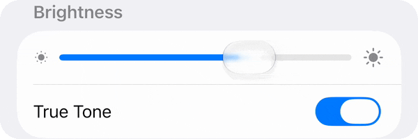<br>
  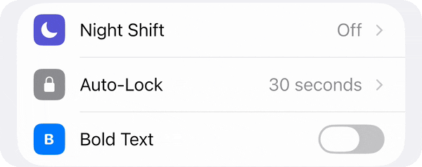<br>
  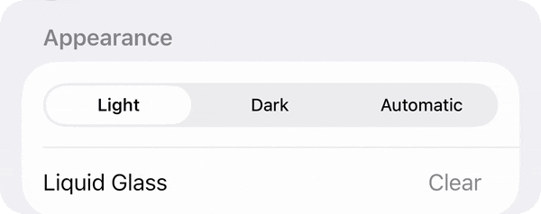
</p>

On iOS&nbsp;26 the slider can also drop its thumb, draw tick marks and fill from a middle value.

<p align="center">
  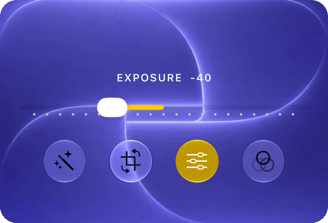
</p>

```dart
CNSlider(value: _brightness, onChanged: (v) => setState(() => _brightness = v))

CNSlider(
  value: _exposure, min: -100, max: 100,
  numberOfTicks: 21, neutralValue: 0, // fills from 0 in both directions
  onChanged: (v) => setState(() => _exposure = v),
)

CNSwitch(value: _trueTone, onChanged: (v) => setState(() => _trueTone = v))

CNSegmentedControl(
  labels: const ['Light', 'Dark', 'Automatic'],
  selectedIndex: _appearance,
  onValueChanged: (i) => setState(() => _appearance = i),
)
```

### Date picker, stepper and colour well

`UIDatePicker`, the system stepper and `UIColorWell`. The compact date picker opens its calendar from the pill, and the colour well opens the system colour picker with its grid, spectrum and eyedropper.

<p align="center">
  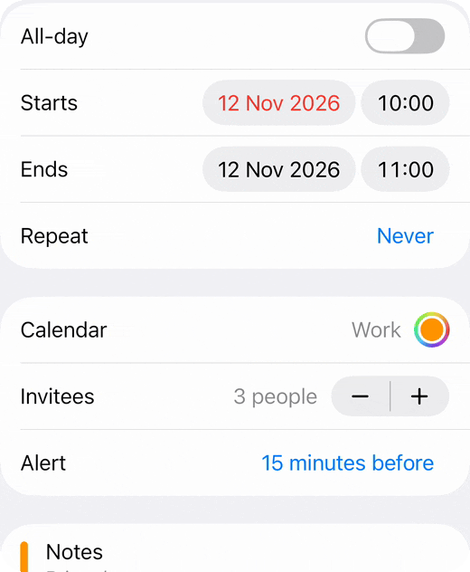
</p>

```dart
CNDatePicker(
  value: _start,
  mode: CNDatePickerMode.dateAndTime,
  style: CNDatePickerStyle.compact,
  onChanged: (d) => setState(() => _start = d),
)

CNStepper(value: _guests, min: 1, max: 20, onChanged: (v) => setState(() => _guests = v))

CNColorWell(color: _color, supportsAlpha: false, onChanged: (c) => setState(() => _color = c))
```

### Symbol effects and page dots

`CNIcon` plays SF Symbol effects: while it is set, once per trigger, or when the symbol changes. `CNPageControl` is `UIPageControl`, kept in step with a `PageView`.

<p align="center">
  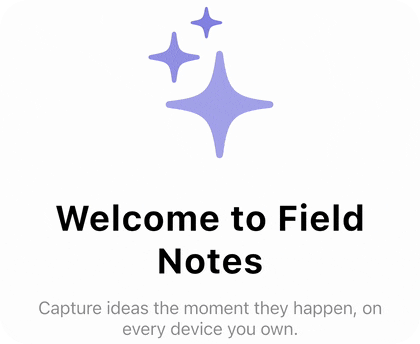
</p>

```dart
CNIcon(symbol: const CNSymbol('waveform'), effect: const CNSymbolEffect.variableColor())

CNIcon(
  symbol: const CNSymbol('bell.fill'),
  triggeredEffect: const CNSymbolEffect.wiggle(),
  effectTrigger: _unread, // plays each time it changes
)

CNPageControl(numberOfPages: 3, controller: _pageController)
```

### Pop-up menus with subtitles and submenus

A real `UIMenu`: subtitles, checkmarks, SF Symbols, destructive items and submenus nested as deep as you need.

<p align="center">
  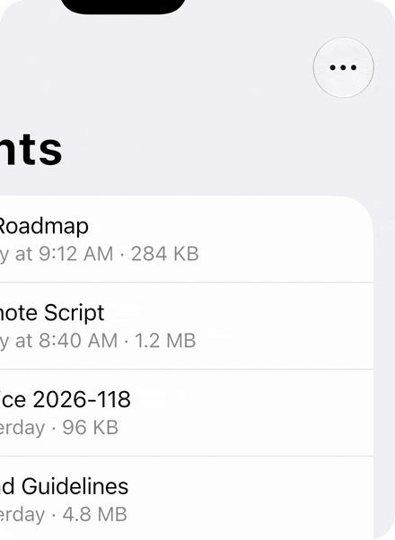
</p>

```dart
CNPopupMenuButton.icon(
  buttonIcon: const CNSymbol('ellipsis'),
  items: [
    const CNPopupMenuItem(label: 'New Folder', icon: CNSymbol('folder.badge.plus')),
    const CNPopupMenuDivider(),
    CNPopupMenuSubmenu(
      label: 'Sort By',
      subtitle: 'Date',
      icon: const CNSymbol('arrow.up.arrow.down'),
      items: [
        for (final name in ['Name', 'Kind', 'Date', 'Size'])
          CNPopupMenuItem(label: name, checked: name == 'Date'),
      ],
    ),
  ],
  onPathSelected: (path) {}, // [2, 0] = Sort By › Name
)
```

A submenu can also show its items in the parent menu, as a row of icons or as a section, and an item can keep the menu open.

<p align="center">
  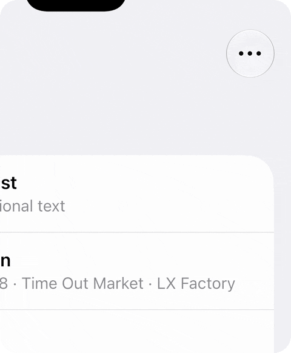
</p>

```dart
CNPopupMenuSubmenu(
  label: 'Format',
  style: CNPopupMenuSubmenuStyle.palette, // or .inline
  items: const [
    CNPopupMenuItem(label: 'Bold', icon: CNSymbol('bold')),
    CNPopupMenuItem(label: 'Italic', icon: CNSymbol('italic')),
  ],
),
const CNPopupMenuItem(label: 'Larger Text', icon: CNSymbol('textformat.size.larger'), keepsMenuPresented: true),
```

### Tab bar

`CNTabBar` is a native `UITabBar` for your own layout, with badges, image assets, a split mode and a separate search tab.

<p align="center">
  
</p>

```dart
CNTabBar(
  items: const [
    CNTabBarItem(label: 'Recents', icon: CNSymbol('clock'), activeIcon: CNSymbol('clock.fill')),
    CNTabBarItem(label: 'Shared', icon: CNSymbol('folder.badge.person.crop')),
    CNTabBarItem(label: 'Browse', icon: CNSymbol('folder'), activeIcon: CNSymbol('folder.fill')),
  ],
  currentIndex: _tab,
  onTap: (i) => setState(() => _tab = i),
  searchItem: const CNTabBarSearchItem(placeholder: 'Search'),
)
```

On macOS the bar is an `NSSegmentedControl` used as tabs, on every version, with the tabs role on macOS&nbsp;27. Each tab shows its symbol or image (`imageAsset`, SVGs too) and its label, the bar draws badges, and a `searchItem` becomes a trailing search tab that calls `onSearchActiveChanged(true)` instead of `onTap`, so the app shows its own search field. AppKit has no split bar and no item menus, so `split` is ignored and an item with `menuItems` is a plain tab. `tint` colours the selection up to macOS&nbsp;26; the macOS&nbsp;27 tabs role draws its own neutral selection.

An item with `menuItems` opens a native menu instead of becoming the selected tab.

<p align="center">
  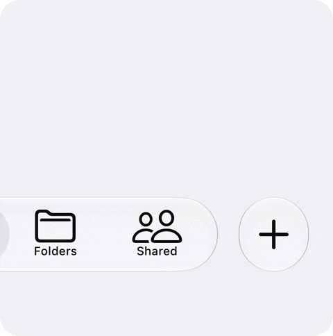
</p>

```dart
CNTabBarItem(
  icon: const CNSymbol('plus'),
  menuItems: const [
    CNPopupMenuItem(label: 'New Note', icon: CNSymbol('square.and.pencil')),
    CNPopupMenuItem(label: 'New Checklist', icon: CNSymbol('checklist')),
  ],
),
// CNTabBar(onMenuSelected: (index, path) Ellipsis)
```

### Native tab bar with minimize on scroll

`CNTabBarNative` presents a SwiftUI `TabView`: the bar minimizes while you scroll, a bottom accessory rides above it, and the search tab is the system's.

<p align="center">
  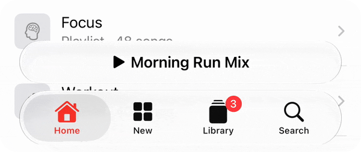
</p>

```dart
await CNTabBarNative.enable(
  asRoot: true,
  showCloseButton: false,
  bottomAccessory: const CNTabAccessory(text: 'Morning Run Mix', sfSymbol: CNSymbol('play.fill')),
  tabs: [
    CNTab(title: 'Home', sfSymbol: const CNSymbol('house.fill'), nativeList: homeList),
    CNTab(title: 'Library', sfSymbol: const CNSymbol('square.stack.fill'), badgeCount: 3, nativeList: libraryList),
    CNTab(title: 'Search', isSearchTab: true, nativeList: searchList),
  ],
);
```

On iOS&nbsp;27, `CNTab(isProminent: true)` sets one tab apart at the end of the bar, as a glass circle.

<p align="center">
  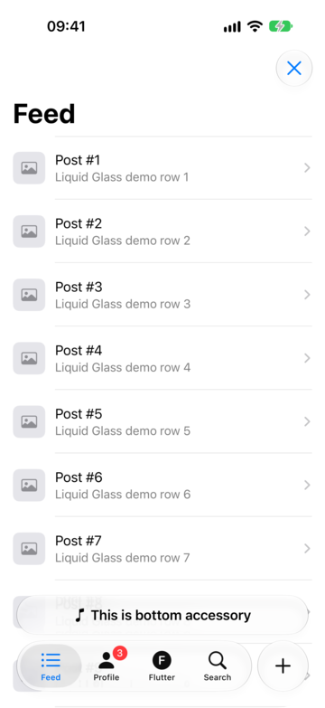
</p>

### Buttons and Liquid Glass

Glass, prominent glass and clear glass buttons, icon buttons with badges, and `CNGlassButtonGroup`, whose buttons share one piece of glass. The glass picks up the colour of whatever is behind it; clear glass, made for photos and video, lets even more of it through.

<p align="center">
  
</p>

```dart
CNButton.icon(icon: const CNSymbol('square.and.arrow.up'), onPressed: share)

CNButton(
  label: 'Done',
  tint: CupertinoColors.systemYellow,
  config: const CNButtonConfig(style: CNButtonStyle.prominentClearGlass),
  onPressed: done,
)

CNGlassButtonGroup(
  buttons: [
    CNButtonData.icon(icon: const CNSymbol('heart'), onPressed: like,
        config: const CNButtonDataConfig(glassEffectUnionId: 'actions')),
    CNButtonData.icon(icon: const CNSymbol('info.circle'), onPressed: info,
        config: const CNButtonDataConfig(glassEffectUnionId: 'actions')),
  ],
)
```

On macOS, `CNButton` and `CNPopupMenuButton` are AppKit buttons on every version: an icon-only button is a circle, a button with a title a capsule. On macOS&nbsp;26 the glass styles use AppKit's glass bezel, and `clearGlass` is a borderless button in a clear `NSGlassEffectView`; before macOS&nbsp;26 the buttons are push buttons, filled with the tint for the prominent styles. `CNGlassButtonGroup` is Liquid Glass on macOS&nbsp;26, with badges and menus, and a row of native buttons before that. Image assets, SVGs and custom icons draw in both.

AppKit glass takes its look from the window's light or dark appearance, not from what is behind it. Over a photo, set the label and icon colours yourself:

```dart
CNButton(
  label: 'Edit',
  icon: const CNSymbol('pencil', color: CupertinoColors.white),
  config: const CNButtonConfig(style: CNButtonStyle.glass, labelColor: CupertinoColors.white),
  onPressed: edit,
)
```

### Alerts and action sheets

`UIAlertController`, with text fields, cancel and destructive actions. On iOS&nbsp;26 an action sheet anchors to the control that opened it.

<p align="center">
  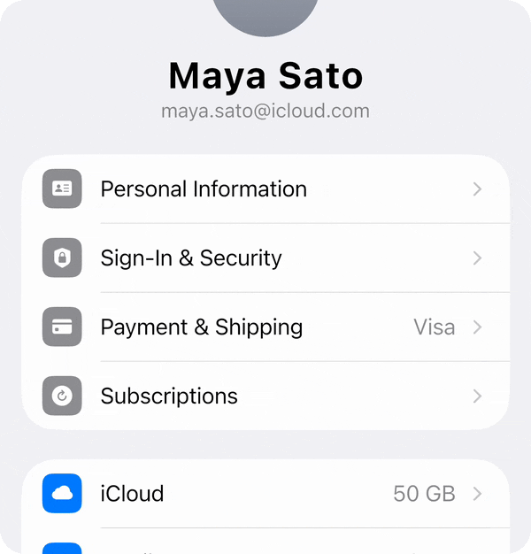
  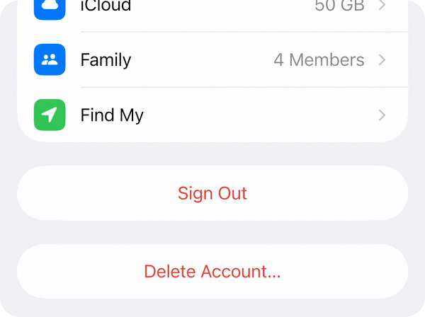
</p>

```dart
final result = await CNAlert.show<String>(
  context: context,
  title: 'Sign Out?',
  actions: const [
    CNAlertAction(label: 'Cancel', isCancel: true),
    CNAlertAction(label: 'Sign Out', value: 'out', isDestructive: true),
  ],
);
```

On macOS, with the same API, `CNAlert` is an `NSAlert` sheet on the window: the default action answers Return, the cancel action Escape, destructive actions are marked, and text fields (secure ones too) sit in the alert. `CNActionSheet` is an `NSMenu` that drops down from `anchorRect`, or an `NSAlert` sheet when there is no anchor; closing the menu resolves to `null`.

### Context menu

<p align="center">
  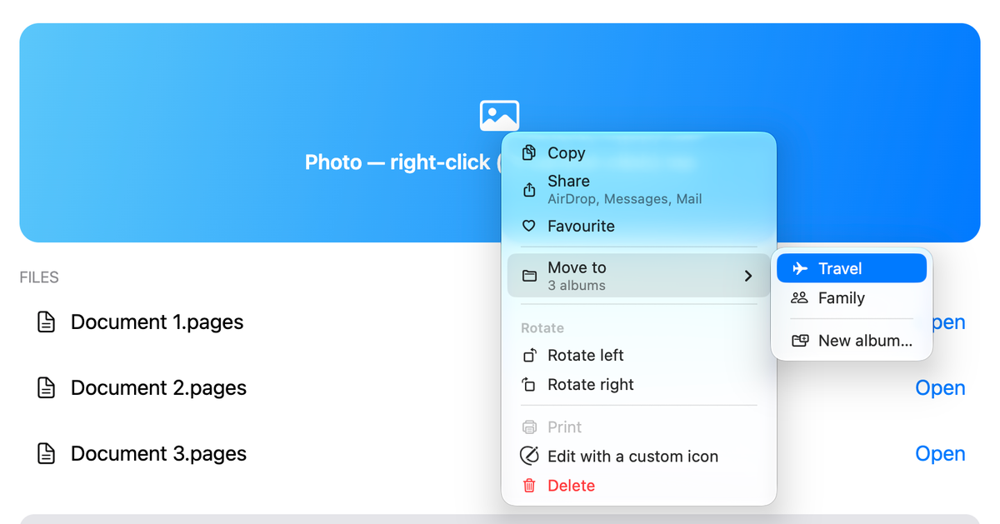
</p>

`CNContextMenu` gives any widget a native context menu. On macOS a right-click, two-finger click or Control-click opens an `NSMenu` at the pointer, also in a window that is in the background. On iOS&nbsp;17.4 and later a long press opens the system menu at the pressed point. It takes the same entries as `CNPopupMenuButton` and reports the path of the chosen item.

```dart
CNContextMenu(
  items: const [
    CNPopupMenuItem(label: 'Copy', icon: CNSymbol('doc.on.doc')),
    CNPopupMenuItem(label: 'Share', subtitle: 'AirDrop, Messages, Mail', icon: CNSymbol('square.and.arrow.up')),
    CNPopupMenuDivider(),
    CNPopupMenuItem(label: 'Delete', icon: CNSymbol('trash'), isDestructive: true),
  ],
  onSelected: (path) {}, // [3] = Delete; dividers count
  child: const PhotoTile(),
)
```

The child keeps its own gestures, so a button inside it still takes taps. On iOS the menu opens as a button's menu does, from the point you pressed, without a lifted preview of the child. Below iOS&nbsp;17.4, and on Android and the web, the menu is a `CupertinoActionSheet`. To open it from code, give it a `GlobalKey<CNContextMenuState>` and call `showMenu()`.

### Progress indicator

<p align="center">
  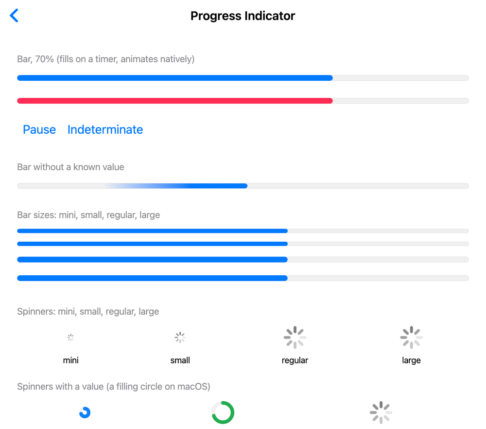
</p>

`CNProgressIndicator` is a native progress bar or spinner: `NSProgressIndicator` on every macOS, `UIProgressView` and `UIActivityIndicatorView` on iOS&nbsp;26. Pass a `value` from 0 to 1 when the progress is known, or leave it `null`.

```dart
CNProgressIndicator(value: _uploaded, semanticLabel: 'Upload') // a bar that fills

CNProgressIndicator(style: CNProgressStyle.spinner, size: CNControlSize.small) // spins
```

iOS has no bar without a value and no spinner that fills, so both show the spinning indicator there. On macOS the spinning indicator is always grey; `tint` colours the bar and the filling circle. Below iOS&nbsp;26 a Flutter bar and `CupertinoActivityIndicator` stand in, and on Android and the web Material's indicators.

### Popover

`CNPopover` shows a native popover that points at a widget: `NSPopover` on macOS and a UIKit popover on iPhone and iPad, where it stays a popover instead of becoming a sheet. Its content is native and described by data: a title and message, `CNListItem` rows (with a checkmark for a choice list), switches that report changes while it stays open, and buttons. `show` returns the id of the chosen row or button, or `null` when the popover is dismissed.

```dart
final sortKey = GlobalKey();
// ...
CNButton(key: sortKey, label: 'Sort', onPressed: () async {
  final id = await CNPopover.show(
    context: context,
    anchorKey: sortKey,
    preferredEdge: CNPopoverEdge.bottom,
    content: CNPopoverContent(
      title: 'Sort By',
      rows: [
        CNPopoverRow(id: 'name', item: const CNListItem(title: 'Name', leadingSymbol: CNSymbol('textformat')), checked: sort == 'name'),
        CNPopoverRow(id: 'date', item: const CNListItem(title: 'Date Modified', leadingSymbol: CNSymbol('calendar')), checked: sort == 'date'),
      ],
      toggles: const [CNPopoverToggle(id: 'hidden', label: 'Show hidden files', value: false)],
    ),
    onToggleChanged: (id, value) {},
  );
  if (id != null) setState(() => sort = id);
})
```

It follows its anchor, and closes when the page changes, on a hot restart and with `CNPopover.dismiss()`. Escape closes it on macOS and Return presses the default button. Flutter widgets cannot go inside it. On Android and the web the same content shows in a Cupertino popup.

### Pop-up button

`CNPopUpButton` picks one value from a short list and shows it, unlike `CNPopupMenuButton`, which runs actions. It is an `NSPopUpButton` on macOS and, on iOS&nbsp;26, a button whose menu selects one item and marks it with a checkmark.

```dart
CNPopUpButton<String>(
  value: size,
  items: const [
    CNPopUpButtonItem(value: 's', label: 'Small', icon: CNSymbol('tortoise')),
    CNPopUpButtonItem(value: 'm', label: 'Medium'),
    CNPopUpButtonDivider(),
    CNPopUpButtonSection(title: 'More', items: [
      CNPopUpButtonItem(value: 'l', label: 'Large', enabled: false),
    ]),
  ],
  onChanged: (v) => setState(() => size = v), // null disables it
)
```

The value is controlled: if `onChanged` keeps the old value, the button goes back to it. It takes the `CNButton` styles, with glass on macOS&nbsp;26 and iOS&nbsp;26, and is as wide as the native control. Below iOS&nbsp;26 a Cupertino button opens an action sheet.

### Gauge

`CNGauge` shows a level. macOS calls it a level indicator and draws it with `NSLevelIndicator`; iOS draws it with SwiftUI's `Gauge`.

```dart
CNGauge(value: 72, max: 100, warningValue: 75, criticalValue: 90,
  label: 'Storage', currentValueLabel: '72 GB',
  minimumValueLabel: '0', maximumValueLabel: '100')

CNGauge(value: rating, max: 5, style: CNGaugeStyle.rating,
  onChanged: (v) => setState(() => rating = v)) // an editable star rating
```

| Style | macOS | iOS&nbsp;26 |
|---|---|---|
| `capacity` | `NSLevelIndicator`, continuous | `Gauge`, linear capacity |
| `discreteCapacity` | `NSLevelIndicator`, discrete, with tick marks | linear capacity, whole units |
| `relevancy` | `NSLevelIndicator`, relevancy | accessory linear capacity |
| `rating` | `NSLevelIndicator`, rating | SF Symbol stars |
| `circularCapacity`, `circular`, `linear` | SwiftUI `Gauge` (a level indicator on macOS&nbsp;12) | SwiftUI `Gauge` |

The bar and ring change colour at `warningValue` and `criticalValue`, also on a scale where low is bad. A gauge that only shows a value lets taps through to the row under it.

### Toolbar

`CNToolbar` is the Apple toolbar: at the top of the window on macOS, at the bottom of the screen on iPhone.

```dart
CNToolbar(title: 'Inbox', subtitle: '3 unread', items: [
  const CNToolbarSidebarToggle(),
  const CNToolbarSidebarTrackingSeparator(),
  CNToolbarSegmentedGroup(label: 'View', selectedIndices: {view}, onSelected: setView,
    segments: const [
      CNToolbarSegment(label: 'List', icon: CNSymbol('list.bullet')),
      CNToolbarSegment(label: 'Grid', icon: CNSymbol('square.grid.2x2')),
    ]),
  const CNToolbarSpace.flexible(),
  CNToolbarMenu(label: 'Sort', icon: const CNSymbol('arrow.up.arrow.down'), items: sortItems, onSelected: sort),
  CNToolbarButton(label: 'New Message', icon: const CNSymbol('square.and.pencil'),
    style: CNToolbarItemStyle.prominent, badge: const CNToolbarBadge.count(3), onPressed: compose),
  CNToolbarSearch(placeholder: 'Search mail', onChanged: filter),
])
```

On macOS the widget takes no room: while it is mounted the window gets an `NSToolbar` (unified, unified compact or expanded) with the title and subtitle, and the Flutter content sits below it. When the widget goes away, or its page is covered, the window gets its own toolbar back. On iOS&nbsp;26 place it at the bottom of the page: it is a Liquid Glass `UIToolbar` with grouped items; search and sidebar items are macOS only, and toolbar badges need iOS&nbsp;27. Items update in place.

### Mac window: sidebar, toolbar and inspector

On macOS, `CNTabBarNative` and `CNNativeSheet` keep their API and become parts of the window. `CNTabBarNative.enable` turns the window into a native split view: the tabs are sidebar rows beside your Flutter content, which is moved, not recreated, and the search tab is the sidebar's search field. `CNNativeSheet.show` opens the window's inspector with the same pages. With `CNToolbar` on top, you get a complete Mac window, as in the picture above. `disable()` and `dismiss()` give the window back as it was.

```dart
await CNTabBarNative.enable(tabs: const [
  CNTab(title: 'Inbox', sfSymbol: CNSymbol('tray'), badgeCount: 3),
  CNTab(title: 'Archive', sfSymbol: CNSymbol('archivebox')),
], onTabSelected: (i) => setState(() => mailbox = i));

await CNNativeSheet.show(pages: const [
  CNSheetPage(title: 'Details', sfSymbol: CNSymbol('info.circle'), items: [
    CNListItem(title: 'From', subtitle: 'Design Team'),
  ]),
]);
```

For a sidebar inside your own layout, use `CNSidebar`: a SwiftUI sidebar list with sections, symbols, badges and selection. `CNTabRail` and `CNTabScaffold` use it on macOS.

```dart
CNSidebar(
  sections: const [
    CNSidebarSection(items: [
      CNSidebarItem(title: 'Inbox', sfSymbol: CNSymbol('tray'), badge: '3'),
      CNSidebarItem(title: 'Archive', sfSymbol: CNSymbol('archivebox')),
    ]),
  ],
  selectedIndex: index,
  onSelected: (i) => setState(() => index = i),
)
```

### Search bar

`CNSearchBar` is a native search field: a SwiftUI search bar on iOS&nbsp;26 and an `NSSearchField` on every macOS. With `expandable` it starts as a magnifying-glass button and opens into the field.

```dart
CNSearchBar(
  placeholder: 'Search Files',
  expandable: false,
  recentsAutosaveName: 'files-search', // macOS: a menu of recent searches
  onChanged: (text) => setState(() => _query = text),
  onSubmitted: search,
)
```

A Mac search field has no Cancel button beside it, so on macOS `showCancelButton` and `cancelText` are not used. Escape clears the text; a second Escape ends the search, closes an expandable bar, calls `onCancelTap` and gives the keyboard back to Flutter. An expandable bar works like a toolbar's search button, and `tint` colours the magnifying glass and the insertion point.

### Native sheet

`CNNativeSheet` presents a `UISheetPresentationController` over the Flutter app. It rests at the heights you give it, keeps the screen behind it usable up to the height you choose, and holds native content: a title with buttons, a list, and a tab bar when it has more than one page. Collapsed, it shrinks to its tab bar.

<p align="center">
  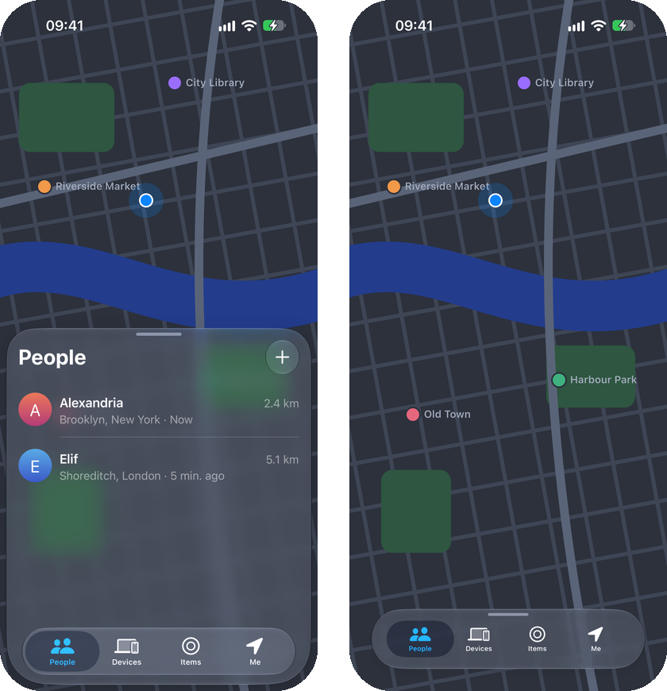
</p>

```dart
await CNNativeSheet.show(
  pages: [
    CNSheetPage(
      title: 'People',
      sfSymbol: CNSymbol('person.2.fill'),
      buttons: [CNSheetButton(id: 'add', sfSymbol: CNSymbol('plus'), label: 'Share My Location')],
      items: [
        CNListItem(
          title: 'Ada',
          subtitle: 'London · Now',
          trailingText: '2 km',
          leadingImage: CNImageAsset('assets/ada.png'),
        ),
      ],
    ),
    CNSheetPage(title: 'Devices', sfSymbol: CNSymbol('macbook.and.iphone')),
  ],
  detents: [CNSheetDetent.collapsed, CNSheetDetent.medium, CNSheetDetent.large],
  initialDetent: CNSheetDetent.medium,
  undimmedDetent: CNSheetDetent.medium, // the map stays usable up to here
  dismissible: false,
  onItemTap: (page, index) {},
);
```

### iPhone Duo

`CNTabScaffold` puts the tabs where the system would: in the vertical bar when the device is closed, in a sidebar when it is open. `CNFoldable` reports the hinge, so a layout can split exactly at the fold.

<p align="center">
  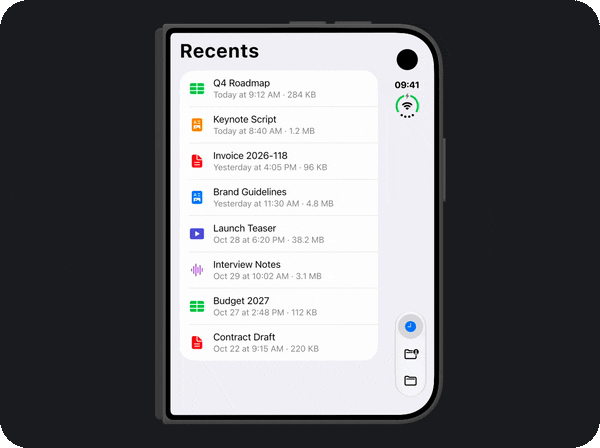
</p>

```dart
CNFoldableScope(
  child: CNTabScaffold(
    items: tabs,
    currentIndex: _tab,
    onTap: (i) => setState(() => _tab = i),
    sidebarOnWideScreens: true,
    body: page,
  ),
)
```

### And more

| Widget | What it is |
|---|---|
| `CNIcon` | SF Symbols drawn by the system, in every rendering mode and with symbol effects, plus your own image assets and `IconData` |
| `CNToast` | Toasts on Liquid Glass, with success, error, warning, info and loading styles |
| `CNFloatingIsland` | A glass island that expands into more content |
| `CNBottomSheet` | Sheets that keep the glass behind them where it belongs |
| `LiquidGlassContainer` | Liquid Glass behind any Flutter widget |
| `CNTabRail` | A vertical glass tab rail or sidebar |
| `CNGlassCard` | An experimental glass card with an optional breathing glow |

Open the example app's **Showcase** section to try every screen above on your own device.

## Guides

### Widgets

| Widget | Description | Controller |
|--------|-------------|:----------:|
| `CNButton` | Native push button with Liquid Glass effects, SF Symbols, and image assets | - |
| `CNButton.icon` | Circular icon-only button variant | - |
| `CNIcon` | Platform-rendered SF Symbols with symbol effects, custom IconData, or image assets | - |
| `CNTabBar` | Native tab bar with split mode for scroll-aware layouts; AppKit tabs on macOS | - |
| `CNTabRail` | Vertical tab bar (glass rail or sidebar) for the side of the screen | - |
| `CNTabScaffold` | Tab layout that moves the tabs to the side on iPhone Duo, like the system | - |
| `CNFoldable` | iPhone Duo hinge (status + angle), vertical-bar side, fold and camera regions | - |
| `CNSlider` | Native slider with min/max range and step support | `CNSliderController` |
| `CNSwitch` | Native toggle switch with animated state changes | `CNSwitchController` |
| `CNDatePicker` | Native date and time picker: compact, inline or wheels | - |
| `CNStepper` | Native − / + stepper | - |
| `CNColorWell` | Native colour well that opens the system colour picker | - |
| `CNProgressIndicator` | Native progress bar or spinner, with or without a value | - |
| `CNGauge` | Native gauge: `NSLevelIndicator` on macOS, SwiftUI `Gauge` on iOS, with an editable rating | - |
| `CNPopUpButton` | Native pop-up button that picks one value and shows it | - |
| `CNPageControl` | Native page dots that can follow a `PageView` | `PageController` |
| `CNPopupMenuButton` | Native popup menu with dividers, icons, image assets, subtitles, submenus, palettes and inline sections | - |
| `CNPopupMenuButton.icon` | Circular icon-only popup menu variant | - |
| `CNActionSheet` | Native `UIAlertController` action sheet with destructive styling; a menu or an `NSAlert` sheet on macOS | - |
| `CNContextMenu` | Native context menu for any widget: right-click on macOS, long press on iOS | - |
| `CNPopover` | Native popover pointing at a widget, with rows, switches and buttons | - |
| `CNToolbar` | Native toolbar: the window toolbar on macOS, a Liquid Glass bottom toolbar on iOS | - |
| `CNSidebar` | Native sidebar list with sections, symbols and badges (macOS; a rail sidebar on iOS) | - |
| `CNAlert` | Native `UIAlertController` alert with text fields and destructive styling; an `NSAlert` sheet on macOS | - |
| `CNSegmentedControl` | Native segmented control with SF Symbols support | - |
| `CNSearchBar` | Native search field: SwiftUI on iOS 26, `NSSearchField` on macOS | `CNSearchBarController` |
| `CNGlassButtonGroup` | Grouped buttons with unified glass blending (tint color support) | - |
| `LiquidGlassContainer` | Apply Liquid Glass effects to any Flutter widget | - |
| `CNGlassCard` | **(Experimental)** Pre-styled card with optional breathing glow animation | - |
| `CNTabBarNative` | **iOS 26 Native Tab Bar** with UITabBarController + search; the window's sidebar on macOS | - |
| `CNToast` | Toast notifications with Liquid Glass effects | - |

### Tab Bar with Split Mode

```dart
CNTabBar(
  items: [
    CNTabBarItem(
      label: 'Home',
      icon: CNSymbol('house'),
      activeIcon: CNSymbol('house.fill'),
    ),
    CNTabBarItem(
      label: 'Profile',
      icon: CNSymbol('person.crop.circle'),
      activeIcon: CNSymbol('person.crop.circle.fill'),
    ),
  ],
  currentIndex: _selectedIndex,
  onTap: (index) => setState(() => _selectedIndex = index),
  iconSize: 25, // Optional: customize icon size (default ~25pt)
  split: true, // Separates tabs when scrolling
  rightCount: 1, // Number of tabs pinned to the right
)
```

#### Precaching `customIcon` items

Items that use `customIcon` (an `IconData`) are rendered to images before the
native bar can be created, so the first mount of a bar shows its Flutter
fallback for a few frames. When a bar appears right after launch, warm the
cache first with the same items and `iconSize` the bar will use:

```dart
await CNTabBar.precacheIcons(items, iconSize: 25);
```

A bar mounted afterwards skips the fallback. SF Symbol and `imageAsset` items
need no precaching.

#### Badges, dots and label fonts

```dart
CNTabBar(
  items: const [
    CNTabBarItem(label: 'Inbox', icon: CNSymbol('tray'), badge: '3'),
    // A small red dot instead of a count, e.g. for "something new".
    CNTabBarItem(label: 'Feed', icon: CNSymbol('sparkles'), badge: CNTabBarItem.dotBadge),
  ],
  currentIndex: _selectedIndex,
  onTap: (index) => setState(() => _selectedIndex = index),
  labelFontFamily: 'Avenir Next', // any font registered with iOS
  labelFontSize: 11,
)
```

`UITabBarItem` has no dot badge, so `CNTabBar` and `CNTabRail` draw
`CNTabBarItem.dotBadge` themselves. VoiceOver reads nothing for a dot, so if
it matters, say what is new in the tab's label. `labelFontFamily` and
`labelFontSize` apply to the native bar, at creation and when they change;
`labelFontSize` alone sizes the system font, and setting both back to null
restores the native label (1.8.3). A taller label moves the icon up to keep
clear of it, and a title wider than a narrow tab (the lone tab in split mode)
shrinks to fit.

#### Items that open a menu

`menuItems` turns an item into a button that opens a native menu instead of
selecting itself, for example a "+" that lets the user pick what to create.
It takes the same entries as `CNPopupMenuButton`, with subtitles and
submenus, and the chosen entry goes to `onMenuSelected` with its path.

```dart
CNTabBar(
  split: true,
  rightCount: 1,
  items: [
    const CNTabBarItem(label: 'Home', icon: CNSymbol('house.fill')),
    const CNTabBarItem(label: 'Library', icon: CNSymbol('books.vertical.fill')),
    const CNTabBarItem(label: 'Profile', icon: CNSymbol('person.fill')),
    CNTabBarItem(
      icon: const CNSymbol('plus'),
      menuItems: const [
        CNPopupMenuItem(label: 'New note', subtitle: 'Text, lists and photos'),
        CNPopupMenuItem(label: 'New folder'),
        CNPopupMenuDivider(),
        CNPopupMenuSubmenu(label: 'Import', items: [
          CNPopupMenuItem(label: 'Photo'),
          CNPopupMenuItem(label: 'File'),
        ]),
      ],
    ),
  ],
  currentIndex: _selectedIndex,
  onTap: (index) => setState(() => _selectedIndex = index),
  // index 3, path [3, 1] for Import > File.
  onMenuSelected: (index, path) => openCreatePage(path),
)
```

An item with a menu never gets selected nor calls `onTap`, and its glass
still reacts under the finger. Sliding a finger along the bar onto it opens
the menu too. Menu entries show SF Symbols and image
assets, not `customIcon`. On the Flutter fallback (iOS < 26, Android, web),
the menu opens as a `CupertinoActionSheet`, as `CNPopupMenuButton`'s does.
On the iOS 26 bar with a `searchItem`, and on the native macOS bar, the item
is a plain tab.

### Native iOS 26 Tab Bar (CNTabBarNative)

> **`CNTabBarNative` is not a Flutter widget — it is a full native takeover.**
> Calling `CNTabBarNative.enable(...)` presents a real iOS 26 Liquid Glass tab bar
> (a SwiftUI `TabView` over a `UITabBarController`) **on top of / in place of** your
> Flutter app. You don't put it in your widget tree and there is **no `currentIndex` /
> `onTap` contract** — you drive it with static methods and react to callbacks.
>
> **iOS 26+ only.** On older iOS, other platforms, or the web, `enable()` is a silent
> no-op (nothing appears). If you need a tab bar that works everywhere and lives inside
> your Flutter tree, use [`CNTabBar`](#tab-bar-with-split-mode) instead.

#### `CNTabBar` vs `CNTabBarNative` — pick the right one

| | **`CNTabBar`** (widget) | **`CNTabBarNative`** (native takeover) |
|---|---|---|
| Where it lives | In your Flutter widget tree | Presented natively over/instead of your app |
| Each tab's content | **Your Flutter screens** (you own navigation) | Native scrolling lists, a native search tab, and/or **one** root-mode Flutter surface |
| Platforms | iOS (Liquid Glass on 26) + graceful Flutter fallback elsewhere | **iOS 26 only** (no-op otherwise) |
| Minimize-on-scroll (shrink) | ✗ | ✅ (`minimizeBehavior`) |
| Apple-Music-style search tab | Split-search variant (`searchItem`) | ✅ Dedicated `Tab(role: .search)` |
| Bottom accessory pill | ✗ | ✅ (`bottomAccessory`) |
| Best for | **A normal app** — Flutter screens per tab | Showcasing iOS 26 native chrome: minimize, native search, accessory |

> ⚠️ **Do _not_** use `CNTabBarNative` as a drop-in for a Flutter bottom nav — e.g.
> calling `enable()` in `initState` and driving an `IndexedStack` /
> `Scaffold.bottomNavigationBar` from `onTabSelected` → `setState`. That creates **two
> sources of truth** for the selected tab (the native bar _and_ your Flutter state),
> which causes the "have to tap twice" behavior and screen rebuilds. For Flutter screens
> per tab, use **`CNTabBar`**.

#### Two presentation modes

`CNTabBarNative` can present in one of two ways, controlled by `asRoot`:

- **Modal (default, `asRoot: false`)** — presented full-screen over your app. Tabs that
  have a `nativeList` show native lists; tabs **without** a list show a placeholder
  (Flutter content requires root mode). Dismiss with `disable()` or the ✕ button.
- **Root (`asRoot: true`)** — replaces the app's root view controller (primary
  navigation). A tab **without** a `nativeList` then hosts your **real Flutter UI**
  (the package re-parents your existing `FlutterViewController` into that tab). This is
  how you mix native list/search tabs with **one** live Flutter "home" surface.

#### Minimal example (modal, native lists + search + minimize)

```dart
await CNTabBarNative.enable(
  tabs: [
    // A tab with a nativeList renders a native scrollable list — and is what
    // lets the bar minimize on scroll (iOS needs a real native scroll view).
    CNTab(
      title: 'Feed',
      sfSymbol: CNSymbol('list.bullet'),
      nativeList: CNNativeList(items: [
        for (var i = 1; i <= 50; i++)
          CNListItem(
            title: 'Post #$i',
            subtitle: 'Row $i',
            leadingSymbol: CNSymbol('photo'),
            showChevron: true,
          ),
      ]),
    ),
    CNTab(
      title: 'Profile',
      sfSymbol: CNSymbol('person'),
      badgeCount: 3,
      nativeList: CNNativeList(items: profileItems),
    ),
    // Apple-Music-style search tab: its OWN screen with its OWN list + search field.
    CNTab(
      title: 'Search',
      isSearchTab: true,
      nativeList: CNNativeList(items: searchableItems),
    ),
  ],
  minimizeBehavior: CNTabMinimizeBehavior.onScrollDown, // shrink on scroll down
  bottomAccessory: CNTabAccessory(
    text: 'Now Playing',
    sfSymbol: CNSymbol('music.note'),
  ),
  tintColor: CupertinoColors.systemBlue,
  isDark: false,
  // Callbacks
  onTabSelected: (i) => debugPrint('tab $i'),
  onListItemTap: (tabIndex, itemIndex) => debugPrint('row $itemIndex in tab $tabIndex'),
  onSearchChanged: (query) => debugPrint('search: $query'),
  onAccessoryTap: () => debugPrint('accessory tapped'),
  onDismissed: () => debugPrint('bar closed (✕ or disable())'),
);

// Later, when leaving the experience:
await CNTabBarNative.disable();
```

#### Tabs — `CNTab`

```dart
CNTab(
  title: 'Feed',                       // shown under the icon
  sfSymbol: CNSymbol('list.bullet'),   // the tab icon (SF Symbol)
  badgeCount: 3,                       // optional red badge
  isSearchTab: false,                  // mark exactly one tab as the search tab
  nativeList: CNNativeList(items: [...]), // optional native list content
)
```

- A tab **with `nativeList`** → a native scrollable list (`CNListItem`s). Required for
  minimize-on-scroll.
- A tab **with `isSearchTab: true`** → the detached iOS 26 search button that morphs into
  a search field (Apple Music style). It is its own destination with its own list.
- A tab with **neither** → hosts your Flutter content in root mode, or a placeholder in
  modal mode.

#### Minimize-on-scroll

```dart
minimizeBehavior: CNTabMinimizeBehavior.onScrollDown,
```

| Value | Behavior |
|---|---|
| `automatic` | System default for the context |
| `never` | Bar stays fully expanded |
| `onScrollDown` | Minimize when scrolling **down**, expand on scroll up |
| `onScrollUp` | Minimize when scrolling **up**, expand on scroll down |

Requires at least one tab backed by a `CNNativeList` (iPhone) — a Flutter list cannot
drive the native minimize. Change it at runtime with `setMinimizeBehavior(...)` (e.g. set
`.never` to keep the bar expanded on a particular screen).

#### Search tab

The search tab is a **separate destination** (not an in-place filter of another tab).
Two ways to populate results:

- **`nativeSearchFilter: true`** (default) — iOS filters the search tab's own
  `nativeList` for you, locally, as the user types.
- **`nativeSearchFilter: false`** — you drive it: listen to `onSearchChanged(query)`, run
  your own search (a backend, or across your own data), and push results into the search
  tab with `setItems(tabIndex: searchTabIndex, items: results)`.

Programmatic helpers: `setSearchText(text)`, `activateSearch()` (select the search tab),
`deactivateSearch()` (clear the query).

#### Bottom accessory pill

A pill that floats above the bar and slides **inline** into it when the bar minimizes.

```dart
bottomAccessory: CNTabAccessory(text: 'Now Playing', sfSymbol: CNSymbol('music.note')),
// ...
onAccessoryTap: () { /* tapped */ },
```

Show / update / hide it after `enable()` with `setBottomAccessory(accessory)` — pass
`null` to hide (e.g. hide it on a specific tab from inside `onTabSelected`).

#### API reference

| Method | What it does |
|---|---|
| `enable({tabs, selectedIndex, minimizeBehavior, bottomAccessory, tintColor, isDark, asRoot, nativeSearchFilter, ...callbacks})` | Present the native tab bar. No-op below iOS 26. |
| `disable()` | Dismiss the bar and return to your app. |
| `isEnabled` | `bool` — whether the bar is currently presented. |
| `setItems({tabIndex, items})` | Replace a tab's native list (async data, pagination, live updates). |
| `setSelectedIndex(index)` | Programmatically select a tab. |
| `setBadgeCounts(List<int?>)` | Per-tab badges (`null`/`0` clears). |
| `setBottomAccessory(accessory?)` | Show / update / hide the accessory (`null` hides). |
| `setStyle({tintColor})` | Update the selected-tab tint. |
| `setBrightness({isDark})` | Switch light/dark appearance. |
| `setMinimizeBehavior(behavior)` | Change when the bar minimizes. |
| `setSearchText(text)` / `activateSearch()` / `deactivateSearch()` | Drive the search tab. |

**Callbacks** (all optional): `onTabSelected(int index)`, `onListItemTap(int tabIndex,
int itemIndex)`, `onSearchChanged(String query)`, `onAccessoryTap()`, `onDismissed()`
(fired when the bar is closed natively via ✕ — reset your own state here).

### Tab Bar with iOS 26 Search Tab

The `CNTabBar` supports iOS 26's native search tab feature with animated expansion:

```dart
CNTabBar(
  items: [
    CNTabBarItem(
      label: 'Overview',
      icon: CNSymbol('square.grid.2x2.fill'),
    ),
    CNTabBarItem(
      label: 'Projects',
      icon: CNSymbol('folder'),
      activeIcon: CNSymbol('folder.fill'),
    ),
  ],
  currentIndex: _index,
  onTap: (i) => setState(() => _index = i),
  // iOS 26 Search Tab Feature
  searchItem: CNTabBarSearchItem(
    placeholder: 'Find customer',
    // Control keyboard auto-activation
    automaticallyActivatesSearch: false, // Keyboard only opens on text field tap
    onSearchChanged: (query) {
      // Live filtering as user types
    },
    onSearchSubmit: (query) {
      // Handle search submission
    },
    onSearchActiveChanged: (isActive) {
      // React to search expand/collapse
    },
    style: const CNTabBarSearchStyle(
      iconSize: 20,
      buttonSize: 44,
      searchBarHeight: 44,
      animationDuration: Duration(milliseconds: 400),
      showClearButton: true,
    ),
  ),
  searchController: _searchController, // Optional programmatic control
)
```

#### automaticallyActivatesSearch

Controls whether the keyboard opens automatically when the search tab expands:

- `true` (default): Tapping the search button expands the bar AND opens the keyboard
- `false`: Tapping the search button only expands the bar; keyboard opens when user taps the text field

This mirrors `UISearchTab.automaticallyActivatesSearch` from UIKit.

### iPhone Duo (foldable)

iPhone Duo folds. Closed, it uses its outer display; open, its larger inner display; partially open, it stands in a *book* pose (fold top to bottom) or a *tabletop* pose (fold left to right). On the outer display, and on the inner display in landscape, iOS 27.1 moves the status bar and the tab bar to a **vertical bar** on one edge.

**`CNTabBarNative`** gets the vertical bar automatically once your app is built with Xcode 27.1. Add `sidebarOnWideScreens: true` to turn the tabs into a native sidebar on the open inner display: beside the content in landscape, behind a sidebar button in portrait.

```dart
CNTabBarNative.enable(
  tabs: [...],
  sidebarOnWideScreens: true,
);
```

**`CNTabScaffold`** does the same for `CNTabBar`, which as a standalone bar never turns vertical on its own. It shows a `CNTabBar` at the bottom, swaps it for a `CNTabRail` in the vertical-bar column whenever iOS uses one, and can show a sidebar on wide screens. The body stays mounted, so folding never resets your page:

```dart
CNFoldableScope( // once, above the app
  child: CNTabScaffold(
    items: const [
      CNTabBarItem(label: 'Home', icon: CNSymbol('house')),
      CNTabBarItem(label: 'Library', icon: CNSymbol('books.vertical')),
    ],
    currentIndex: index,
    onTap: (i) => setState(() => index = i),
    sidebarOnWideScreens: true,
    body: pages[index],
  ),
)
```

**`CNFoldable`** reports the hinge, the vertical bar and the screen's reserved regions. `CNFoldableScope` also adds the fold and the camera to `MediaQuery.displayFeatures`, so Flutter's own dialogs and popups keep clear of the fold when the device is partially open:

```dart
final duo = CNFoldable.of(context);

duo.hinge?.status;     // CNHingeStatus.closed / partiallyOpen / fullyOpen
duo.hinge?.degrees;    // 0 (shut) … 180 (flat)
duo.verticalBarSide;   // CNVerticalBarSide.none / left / right
duo.activeFold?.frame; // where the fold is, in logical pixels
```

Use the hinge angle for effects and the status and regions for layout, as Apple recommends. The *iPhone Duo* page of the example app splits a player at the fold (artwork above it in the tabletop pose, a list beside it in the book pose) and reflows an even-numbered grid.

> **Requirements:** iOS 27.1 and Xcode 27.1 (the iOS 27.1 SDK). Built with an older Xcode the package still compiles; `CNFoldable` then reports `CNFoldableState.unsupported` and `CNTabScaffold` keeps a bottom bar.
>
> **Your own layouts:** on the outer display the vertical status bar adds a safe-area inset on one side. `ListView` pads only along its scroll axis, so wrap content in `SafeArea(top: false, bottom: false, …)` (or use `CNTabScaffold`'s body) to keep it clear.
>
> **Simulator:** Xcode 27.1 replaces Simulator with Device Hub. The *Closed*, *Partially Open* and *Open* pose buttons sit below the device; hold Option and drag the slider for any angle.

### Native sheet (CNNativeSheet)

`CNNativeSheet` is a `UISheetPresentationController` presented over the Flutter app, with SwiftUI content that the package builds from your Dart descriptions. It is a static API: `show` presents the sheet, the setters update it, `dismiss` closes it. One sheet is shown at a time; calling `show` again replaces it.

**Heights.** Pass the heights the sheet may rest at as `detents`, and the one it opens at as `initialDetent` (the first by default):

| `CNSheetDetent` | Rests at |
|---|---|
| `collapsed` | Only the tab bar. On iOS&nbsp;26 and later the sheet becomes a glass capsule; as it gets there, the page fades out and the tab bar settles in the middle. For sheets with more than one page |
| `medium` | About half the screen |
| `large` | Nearly the full screen |
| `height(points)` | A fixed height |
| `fraction(f)` | A fraction of the largest height, from 0 to 1 |

**The screen behind.** Up to and including `undimmedDetent` the Flutter screen behind the sheet is not dimmed and keeps taking touches, so a map can still be panned. Leave it null to dim at every height. `dismissible: false` keeps the sheet from being dragged closed.

**Content.** Each `CNSheetPage` has a `title`, `buttons` beside it (`CNSheetButton` with an `id`, an `sfSymbol` and a `label` that VoiceOver reads) and `items`. Rows are `CNListItem`s: `title`, `subtitle`, `trailingText`, a `leadingImage` or `leadingSymbol`, and `showChevron`. With more than one page, each page gets a tab from its `title` and `sfSymbol` (`activeSfSymbol` while selected, `badgeCount` for a badge).

**Events and updates.**

```dart
await CNNativeSheet.show(
  pages: pages,
  detents: const [CNSheetDetent.collapsed, CNSheetDetent.medium, CNSheetDetent.large],
  onDetentChanged: (detent) {},     // the user dragged it to another height
  onPageSelected: (page) {},        // a tab was chosen
  onItemTap: (page, index) {},
  onButtonTap: (page, id) {},
  onDismissed: () {},
);

await CNNativeSheet.setItems(page: 0, items: people);   // new rows
await CNNativeSheet.setBadgeCounts([2, null]);
await CNNativeSheet.setSelectedPage(1);
await CNNativeSheet.setDetent(CNSheetDetent.large);
await CNNativeSheet.setBrightness(isDark: true);
await CNNativeSheet.dismiss();
```

> **Native content only.** An iOS app has one Flutter view, and it stays behind the sheet, so Flutter widgets cannot be placed inside. The sheet shows what `CNSheetPage` and `CNListItem` describe.
>
> **Platforms.** iOS&nbsp;17 and later; Liquid Glass and the collapsed capsule on iOS&nbsp;26 and later. Elsewhere `show` does nothing and returns `false`, so show your own sheet when it does.

### macOS

Since 2.2 a widget whose control exists in AppKit uses it on every supported macOS, 12.0 and later, not only on macOS&nbsp;26. Liquid Glass still needs macOS&nbsp;26: below it, the same widgets keep their AppKit look without glass.

| Widget | On macOS |
|--------|----------|
| `CNButton`, `CNPopupMenuButton` | `NSButton` (with an `NSMenu`): glass bezels on macOS&nbsp;26, push and circular buttons before |
| `CNSlider`, `CNStepper`, `CNDatePicker`, `CNColorWell`, `CNSegmentedControl` | `NSSlider`, `NSStepper`, `NSDatePicker`, `NSColorWell`, `NSSegmentedControl` |
| `CNSwitch` | The AppKit switch, through a SwiftUI toggle, which takes a tint |
| `CNTabBar` | An `NSSegmentedControl` used as tabs, with the tabs role on macOS&nbsp;27 |
| `CNSearchBar` | `NSSearchField` |
| `CNProgressIndicator` | `NSProgressIndicator`, through SwiftUI's `ProgressView` |
| `CNIcon` | SF Symbols, image assets, SVGs and custom icons |
| `CNAlert`, `CNActionSheet` | An `NSAlert` sheet; an `NSMenu` for an anchored action sheet |
| `CNContextMenu`, `CNPopupGesture` | An `NSMenu` at the pointer on a secondary click |
| `LiquidGlassContainer` | `NSGlassEffectView` on macOS&nbsp;26, `NSVisualEffectView` before |
| `CNGlassButtonGroup` | Liquid Glass on macOS&nbsp;26; a row of native buttons before |
| `CNToast` | Flutter, on native glass on macOS&nbsp;26 |
| `CNTabBarNative` | The window's sidebar: an `NSSplitViewController` around your Flutter content, with the search tab as the sidebar's search field (2.3) |
| `CNNativeSheet` | The window's inspector, with a page switcher (2.3) |
| `CNToolbar`, `CNSearchScaffold` | The window's `NSToolbar`, with `NSSearchToolbarItem` (2.3) |
| `CNPopover` | `NSPopover` (2.3) |
| `CNPopUpButton` | `NSPopUpButton` (2.3) |
| `CNGauge` | `NSLevelIndicator`, or SwiftUI `Gauge` for the rings (2.3) |
| `CNSidebar`, `CNTabRail`, `CNTabScaffold` | A SwiftUI sidebar list (2.3) |
| `CNFloatingIsland`, `CNPageControl` | Drawn in Flutter |
| `CNFoldable` | iPhone Duo only |

**What AppKit has no place for.** These options are ignored on macOS:

- `CNTabBar`: `split` (the tabs stay in one control), item `menuItems` (a plain tab), and `tint` on macOS&nbsp;27, where the tabs role draws its own neutral selection.
- `CNStepper.color` and `CNDatePicker.tint`: AppKit's stepper and date picker take no tint; the date picker follows the system accent colour.
- `CNSlider`: `thumbColor`, `trackBackgroundColor` and `CNSliderStyle.thumbless`. The track takes `trackColor` or `color`.
- `CNSearchBar`: `showCancelButton` and `cancelText`. Escape is the cancel gesture.
- `CNColorWell`: `title` and `supportsEyedropper`; `supportsAlpha` needs macOS&nbsp;14.
- `CNPopupMenuButton`: `elementSize` and `keepsMenuPresented`; a palette shows as a section.
- `LiquidGlassContainer`: `interactive`; `CNGlassEffect.prominent` is regular glass.

**Things to know.**

- AppKit glass takes its look from the window's light or dark appearance, not from what is behind it. Over a photo, set `labelColor` and the icon colours yourself.
- SVGs are read by `NSImage`, so they stay vector.
- Menus hold only your entries: the items macOS adds to context menus, such as Ask Siri, are left out. Item icons stay visible on macOS&nbsp;27, which hides them by default.
- VoiceOver cannot open a `CNContextMenu` on macOS: Flutter gives a widget no Show Menu action there.
- The package's minimum is macOS&nbsp;12.0, as Xcode&nbsp;27.1 rejects older deployment targets. Set your app's `MACOSX_DEPLOYMENT_TARGET` to 12.0 or later, and with CocoaPods `platform :osx, '12.0'` in `macos/Podfile`.
- `CNTabBarNative` on macOS: `bottomAccessory` and `minimizeBehavior` have no Mac counterpart. `CNNativeSheet` on macOS: detents are ignored. The window gets View › Show Sidebar (⌃⌘S).
- 2.2 and 2.3 were checked on macOS&nbsp;27.2. The code paths for macOS&nbsp;12 to 26 were reviewed, not run on those versions.

### Accessibility

The widgets that render natively are real UIKit and SwiftUI controls, so VoiceOver, Voice Control and Switch Control see the system's own controls rather than an imitation. Checked through the iOS accessibility tree (iPhone Duo simulator, iOS 27.1), and for the macOS controls of 2.2.0 through the macOS accessibility tree (macOS 27.2). The `CNContextMenu` row follows from its implementation:

| Widget | What VoiceOver gets |
|--------|---------------------|
| `CNButton`, `CNButton.icon` | A button, named by its title or `semanticLabel` |
| `CNPopupMenuButton` | A button that opens the system menu |
| `CNSlider` | An adjustable slider with its value; swipe up or down to change it |
| `CNSwitch` | A switch with its on/off state |
| `CNSegmentedControl` | A group of segments, named by its `semanticLabel`, each with its title |
| `CNTabRail` | A button per tab, with its badge as the value and the selected state |
| `CNTabBarNative`, `CNAlert`, `CNActionSheet` | System controllers, presented by iOS |
| `CNNativeSheet` | A system sheet: the page title as a heading, each button by its `label`, each row as one element |
| `CNContextMenu` | The child, with the menu as its long-press action (double-tap and hold) |
| `CNProgressIndicator` | Its `semanticLabel` with the progress as a percentage ("Upload, 40 percent") |
| `CNPopover` | A modal popover: VoiceOver stays inside it, and the escape gesture (two-finger scrub) closes it |
| `CNPopUpButton` | A pop-up button with its `semanticLabel` and the selected item as its value |
| `CNGauge` | Its label and value; the editable rating is adjustable (swipe up or down) |
| `CNToolbar` | Each item by its label, the badge as its value |

**Name every icon-only control.** Without a name, an icon-only button is read by its SF Symbol's built-in name, which describes the picture rather than the action (`moon` is read as "do not disturb"), and a switch or slider has no name at all: a native control cannot merge with the Flutter text next to it. Pass `semanticLabel`:

```dart
CNButton.icon(
  icon: const CNSymbol('moon'),
  semanticLabel: 'Switch to dark mode',
  onPressed: toggleTheme,
)

CNSwitch(value: wifi, semanticLabel: 'Wi-Fi', onChanged: setWifi)
CNSlider(value: volume, semanticLabel: 'Volume', onChanged: setVolume)
```

**macOS.** The controls are AppKit controls, so VoiceOver on the Mac reads them as the system's own, and `semanticLabel` names them there too: `CNButton`, `CNPopupMenuButton`, `CNSlider`, `CNSwitch`, `CNSegmentedControl`, `CNStepper`, `CNDatePicker`, `CNColorWell` and `CNProgressIndicator`. A `CNTabBar` badge is read as the tab's help. VoiceOver cannot open a `CNContextMenu` on macOS, because Flutter gives a widget no Show Menu action there; offer the same actions in a visible control too, such as a `CNPopupMenuButton`.

**Dynamic Type.** Button titles follow the system text size. Tab bars, the tab rail and segmented controls keep a fixed size, as they do throughout iOS, and offer the **Large Content Viewer** instead: with a large text size, long-press an item to see it enlarged. `CNTabBar` and `CNTabBarNative` are system tab bars, and `CNTabRail` adopts the viewer as well.

> **Known Flutter limitation ([flutter/flutter#194389](https://github.com/flutter/flutter/issues/194389)):** VoiceOver *touch exploration* — moving a finger over the screen to find an element — does not reach a native control that shares its area with a scrolling Flutter list, because Flutter's accessibility hit test returns the list first. That covers controls placed inside a `ListView`, and a `CNTabBar` or `CNTabScaffold` bar floating over scrolling content. `CNTabBarNative` is not affected: its tab bar is a real `UITabBarController` outside Flutter's view. Where touch exploration of the tab bar matters, prefer `CNTabBarNative`.

### Icon Support

All widgets support three icon types with unified priority:

1. **Image Assets** (highest priority) - PNG, SVG, JPG with automatic resolution selection
2. **Custom Icons** - Any `IconData` (CupertinoIcons, Icons, custom)
3. **SF Symbols** - Native Apple SF Symbols with rendering modes

```dart
// SF Symbol
CNButton(
  label: 'Settings',
  icon: CNSymbol('gear', size: 20),
  onPressed: () {},
)

// Custom Icon
CNButton(
  label: 'Home',
  customIcon: CupertinoIcons.home,
  onPressed: () {},
)

// Image Asset
CNButton(
  label: 'Custom',
  imageAsset: CNImageAsset('assets/icons/custom.png', size: 20),
  onPressed: () {},
)
```

### Button Styles

```dart
CNButtonStyle.plain           // Minimal, text-only
CNButtonStyle.gray            // Subtle gray background
CNButtonStyle.tinted          // Tinted text
CNButtonStyle.bordered        // Bordered outline
CNButtonStyle.borderedProminent // Accent-colored border
CNButtonStyle.filled          // Solid filled background
CNButtonStyle.glass           // Liquid Glass effect (iOS 26+, macOS 26+)
CNButtonStyle.prominentGlass  // Prominent glass effect (iOS 26+, macOS 26+)
CNButtonStyle.clearGlass      // Clear glass, for buttons over media (iOS 26+, macOS 26+)
CNButtonStyle.prominentClearGlass // Clear glass tinted with the button's tint (iOS 26+, macOS 26+)
```

### Glass Effect Unioning

Multiple buttons can share a unified glass effect:

```dart
Row(
  children: [
    CNButton(
      label: 'Left',
      config: CNButtonConfig(
        style: CNButtonStyle.glass,
        glassEffectUnionId: 'toolbar',
      ),
      onPressed: () {},
    ),
    CNButton(
      label: 'Right',
      config: CNButtonConfig(
        style: CNButtonStyle.glass,
        glassEffectUnionId: 'toolbar',
      ),
      onPressed: () {},
    ),
  ],
)
```

## Usage

### Basic Button

```dart
CNButton(
  label: 'Get Started',
  icon: CNSymbol('arrow.right', size: 18),
  config: CNButtonConfig(
    style: CNButtonStyle.filled,
    imagePlacement: CNImagePlacement.trailing,
  ),
  onPressed: () {
    // Handle tap
  },
)
```

### Button Styles Gallery

### Icon-Only Button

```dart
CNButton.icon(
  icon: CNSymbol('plus', size: 24),
  config: CNButtonConfig(style: CNButtonStyle.glass),
  onPressed: () {},
)
```

### Native Icons

```dart
CNIcon(
  symbol: CNSymbol(
    'star.fill',
    size: 32,
    color: Colors.amber,
    mode: CNSymbolRenderingMode.multicolor,
  ),
)
```

### Slider with Controller

```dart
final controller = CNSliderController();

CNSlider(
  value: 0.5,
  min: 0,
  max: 1,
  controller: controller,
  onChanged: (value) {
    print('Value: $value');
  },
)

// Programmatic update
controller.setValue(0.75);
```

### Switch with Controller

```dart
final controller = CNSwitchController();

CNSwitch(
  value: _isEnabled,
  onChanged: (value) {
    setState(() => _isEnabled = value);
  },
  controller: controller,
  color: Colors.green, // Optional tint color
)

// Programmatic control
controller.setValue(true, animated: true);
controller.setEnabled(false); // Disable interaction
```

### Popup Menu Button

```dart
// Text-labeled popup menu
CNPopupMenuButton(
  buttonLabel: 'Options',
  buttonStyle: CNButtonStyle.glass,
  items: [
    CNPopupMenuItem(
      label: 'Edit',
      icon: CNSymbol('pencil'),
    ),
    CNPopupMenuItem(
      label: 'Share',
      icon: CNSymbol('square.and.arrow.up'),
    ),
    const CNPopupMenuDivider(), // Visual separator
    CNPopupMenuItem(
      label: 'Delete',
      icon: CNSymbol('trash', color: Colors.red),
      enabled: true,
    ),
  ],
  onSelected: (index) {
    print('Selected item at index: $index');
  },
)

// Icon-only popup menu (circular glass button)
CNPopupMenuButton.icon(
  buttonIcon: CNSymbol('ellipsis.circle', size: 24),
  buttonStyle: CNButtonStyle.glass,
  items: [
    CNPopupMenuItem(label: 'Option 1', icon: CNSymbol('star')),
    CNPopupMenuItem(label: 'Option 2', icon: CNSymbol('heart')),
  ],
  onSelected: (index) {},
)
```

#### Subtitles and submenus

`subtitle` adds a second line under an item's label. `CNPopupMenuSubmenu` opens a nested menu, and can itself contain submenus. On iOS they are the system's `UIAction.subtitle` and nested `UIMenu`; on macOS `NSMenuItem.subtitle` (macOS 14.4+) and `NSMenuItem.submenu`; the `CupertinoActionSheet` fallback shows the subtitle as a smaller line and opens each submenu as a second sheet.

```dart
CNPopupMenuButton(
  buttonLabel: 'Actions',
  items: const [
    CNPopupMenuItem(label: 'Rename', subtitle: 'Also renames the file'),
    CNPopupMenuDivider(),
    CNPopupMenuSubmenu(
      label: 'Export',
      subtitle: '3 formats',
      icon: CNSymbol('square.and.arrow.up'),
      items: [
        CNPopupMenuItem(label: 'PDF'),
        CNPopupMenuSubmenu(
          label: 'Spreadsheet',
          items: [
            CNPopupMenuItem(label: 'CSV'),
            CNPopupMenuItem(label: 'Numbers'),
          ],
        ),
      ],
    ),
  ],
  onPathSelected: (path) {
    // [0]       → Rename
    // [2, 0]    → Export › PDF
    // [2, 1, 0] → Export › Spreadsheet › CSV
  },
)
```

`onPathSelected` is called for every selection with the path to the selected item: one index per level, dividers included, as in `onSelected`. `onSelected` still gets an index in `items`; for an item inside a submenu, that is the index of the top-level submenu it is under. At least one of the two callbacks is required, and `onPathSelected` is required as soon as `items` contain a submenu. When both are set, both are called.

### Action Sheet

An imperative API, like `CNToast.show`. On iOS it presents a real
`UIAlertController` in `.actionSheet` style, so the sheet is the system
control — system destructive red, VoiceOver, Dynamic Type, and on iOS 26 the
Liquid Glass appearance, which the system applies with no opt-in. Because the
appearance comes from the OS, the native path is used on **every** supported
iOS version instead of being gated on iOS 26. macOS has no action sheet, so
there it is the control that does the job on a Mac (see
[On macOS](#on-macos) below). Other platforms fall back to
`CupertinoActionSheet`.

```dart
final choice = await CNActionSheet.show<String>(
  context: context,
  title: 'Delete photo?',
  message: 'This cannot be undone.',
  actions: const [
    CNActionSheetAction(
      label: 'Delete',
      value: 'delete',
      isDestructive: true,
    ),
    CNActionSheetAction(label: 'Duplicate', value: 'duplicate'),
    CNActionSheetAction(label: 'Export as PDF', value: 'pdf', enabled: false),
  ],
  cancelLabel: 'Cancel',
);

if (choice == 'delete') _deletePhoto();
```

`show` resolves to the selected action's `value`, or `null` when the sheet is
cancelled or dismissed.

#### Anchoring — read this before shipping

Starting in iOS 26 an action sheet anchors to the view it came from **on iPhone
as well as iPad**, appearing directly over that view instead of sliding up from
the bottom ([WWDC25](https://developer.apple.com/forums/thread/803824)). Pass
`anchorRect` — the global rect of the widget that triggered the sheet — to get
that presentation and its transition:

```dart
final box = _buttonKey.currentContext!.findRenderObject()! as RenderBox;

await CNActionSheet.show<String>(
  context: context,
  anchorRect: box.localToGlobal(Offset.zero) & box.size,
  actions: const [
    CNActionSheetAction(label: 'Share', value: 'share'),
    CNActionSheetAction(label: 'Remove', value: 'remove', isDestructive: true),
  ],
);
```

Omitting `anchorRect` is still valid — the system centres the sheet. Two things
to know about that path:

- On iOS 26 a centred sheet groups the cancel button with the actions (side by
  side when there is only one action), rather than the detached bottom row
  older iOS used.
- Below iOS 26 UIKit adds no cancel button of its own, so the sheet shows
  exactly the actions you passed. Without a `cancelLabel` the only way out is to
  pick one, so pass one unless forcing a choice is what you want.

What `anchorRect` itself does depends on the presentation the OS picks:

- On iPad, and on iPhone from iOS 26, the sheet is a popover: it drops the
  cancel button and is dismissed by tapping outside, so passing `cancelLabel`
  alongside `anchorRect` is harmless — it simply does not render.
- On iPhone below iOS 26 `anchorRect` does not turn the sheet into a popover.
  It still slides up from the bottom, still renders `cancelLabel` and still has
  no outside-tap dismissal, so pass one.

#### On macOS

- **With `anchorRect`:** an `NSMenu` that drops down from the anchor, as a
  pull-down button's menu does. `title` is a section header with `message`
  under it, there is one item per action, and destructive actions are in
  the system red. Escape or a click outside closes the menu and resolves to
  `null`, so `cancelLabel` adds no item.
- **Without an anchor:** an `NSAlert` sheet on the window, with one button
  per action and, when `cancelLabel` is set, a cancel button that answers
  Escape. No button answers Return: an action sheet has no preferred action.

#### Content guidance

Apple's [HIG](https://developer.apple.com/design/human-interface-guidelines/action-sheets)
puts destructive choices at the top and caps the sheet at four buttons including
cancel. `CNActionSheet` preserves the order you pass — reordering would silently
break the index-to-`value` mapping — so put the destructive action first
yourself.

#### No per-action icons

`UIAlertAction` exposes no public image property, so `CNActionSheetAction` has
no icon field. The `setValue(_:forKey: "image")` workaround seen in the wild is
KVC against an undeclared private property: it risks App Store rejection and
breaks silently across iOS releases. Use [`CNPopupMenuButton`](#popup-menu-button)
when you need icons — its `UIMenu` path has a public image API.

### Alert

An imperative API like `CNActionSheet.show`. On iOS it presents a real
`UIAlertController` in `.alert` style — system typography, the destructive
red, VoiceOver, Dynamic Type, and on iOS 26 the Liquid Glass appearance — on
every supported iOS version. On macOS it presents a real `NSAlert` as a sheet
on the window (see below). Other platforms fall back to
`CupertinoAlertDialog`.

```dart
final result = await CNAlert.show<String>(
  context: context,
  title: 'Delete photo?',
  message: 'This cannot be undone.',
  actions: const [
    CNAlertAction(label: 'Cancel', isCancel: true),
    CNAlertAction(label: 'Delete', value: 'delete', isDestructive: true),
  ],
);

if (result?.value == 'delete') _deletePhoto();
```

Text fields come back in `CNAlertResult.textFields`, in order:

```dart
final result = await CNAlert.show<String>(
  context: context,
  title: 'Rename',
  textFields: const [
    CNAlertTextField(placeholder: 'Name', initialText: 'Untitled'),
  ],
  actions: const [
    CNAlertAction(label: 'Cancel', isCancel: true),
    CNAlertAction(label: 'Save', value: 'save', isDefault: true),
  ],
);

if (result?.value == 'save') rename(result!.textFields.first);
```

`show` resolves to a `CNAlertResult` for every button press, cancel included,
and to `null` when no answer was produced — for example when, on iOS, a
second `CNAlert.show` replaced this alert. Things to know:

- An alert cannot be dismissed by tapping outside, so pass at least one
  enabled action. A call with none asserts in debug and resolves to `null`
  without presenting in release.
- At most one action may be `isCancel` and at most one `isDefault`; UIKit
  cannot render more.
- `UIAlertController` has no public API for custom content or action icons,
  so `CNAlert` offers neither.

On every macOS version the alert is an `NSAlert` sheet on the app's window,
never a blocking modal loop:

- The `isDefault` action sits at the trailing edge and answers Return; the
  `isCancel` action sits next to it and answers Escape. Without an
  `isDefault` action, the first action that is not the cancel action takes
  Return, unless it is destructive.
- `isDestructive` marks the button as destructive
  (`NSButton.hasDestructiveAction`).
- Text fields are `NSTextField`s, `NSSecureTextField` when `obscureText` is
  set, in the alert; the first one has the focus.
- The alert shows the app icon, as every `NSAlert` does. A second
  `CNAlert.show` closes the first, which resolves to `null`.

### Segmented Control

```dart
// Text-only segments
CNSegmentedControl(
  labels: ['Day', 'Week', 'Month', 'Year'],
  selectedIndex: _selectedIndex,
  onValueChanged: (index) {
    setState(() => _selectedIndex = index);
  },
  color: Colors.blue, // Optional tint color
  semanticLabel: 'Period', // What VoiceOver calls the control (2.2)
)

// Segments with SF Symbols
CNSegmentedControl(
  labels: ['List', 'Grid', 'Gallery'],
  sfSymbols: [
    CNSymbol('list.bullet'),
    CNSymbol('square.grid.2x2'),
    CNSymbol('photo.on.rectangle'),
  ],
  selectedIndex: _viewMode,
  onValueChanged: (index) {
    setState(() => _viewMode = index);
  },
  shrinkWrap: true, // Size to content
)
```

### Liquid Glass Container

```dart
LiquidGlassContainer(
  config: LiquidGlassConfig(
    effect: CNGlassEffect.regular,
    shape: CNGlassEffectShape.rect,
    cornerRadius: 16,
    interactive: true,
  ),
  child: Padding(
    padding: EdgeInsets.all(16),
    child: Text('Glass Effect'),
  ),
)

// Or use the extension
Text('Glass Effect')
  .liquidGlass(cornerRadius: 16)
```

The glass takes the size of its child. In a parent that stretches its
children, such as a `ListView`, wrap it in an `Align` to keep it to the
child's width.

On macOS 26 the glass is AppKit's `NSGlassEffectView` (regular or clear,
tinted with `tint`); before macOS 26 it is an `NSVisualEffectView`, the
translucent material that came before Liquid Glass. `CNGlassEffect.prominent`
draws as regular glass, and the glass is not interactive on macOS. AppKit
glass takes its look from the window's light or dark appearance, not from
what is behind it, so over a photo give the child its own text colours.

### Experimental: Glass Card

```dart
CNGlassCard(
  child: Text("Hello"),
  breathing: true, // Optional subtle glow animation
)
```

## Performance Best Practices

### ⚠️ LiquidGlassContainer & Lists

`LiquidGlassContainer` uses a **Platform View** (`UiKitView` / `AppKitView`) under the hood. While powerful, platform views are more expensive than standard Flutter widgets.

*   **DO NOT** use `LiquidGlassContainer` inside long scrolling lists (`ListView.builder`, `GridView`) with many items. This will cause significant performance drops (jank).
*   **DO** use `LiquidGlassContainer` for static elements like Cards, Headers, Navigation Bars, or Floating Action Buttons.

## Platform Fallbacks

| Platform | Liquid Glass | SF Symbols | Other widgets |
|----------|:------------:|:----------:|:-------------:|
| iOS 26+ | Native | Native | Native (UIKit, SwiftUI) |
| iOS 15–25 | Cupertino fallback | Native via CNIcon | Cupertino widgets; alerts, action sheets and context menus stay native |
| macOS 26+ | Native | Native | Native (AppKit, SwiftUI) |
| macOS 12–15 | None; an AppKit material behind `LiquidGlassContainer` | Native | Native (AppKit, SwiftUI) |
| Android/Web/etc | Material fallback | Flutter Icon | Material and Cupertino fallbacks |

Widget by widget:

| Widget | iOS 26+ | iOS 15–25 | macOS 26+ | macOS 12–15 | Android, web |
|--------|---------|-----------|-----------|-------------|--------------|
| `CNButton`, `CNPopupMenuButton` | Native | Flutter | Native, glass bezels | Native | Flutter |
| `CNSlider`, `CNSwitch`, `CNSegmentedControl`, `CNDatePicker`, `CNStepper`, `CNColorWell` | Native | Flutter | Native | Native | Flutter |
| `CNProgressIndicator` | Native | Flutter | Native | Native | Flutter |
| `CNIcon` | Native | Native | Native | Native | Flutter `Icon` |
| `CNTabBar` | Native | `CupertinoTabBar` | Native tabs | Native tabs | `CupertinoTabBar` |
| `CNSearchBar` | Native, glass | Flutter | `NSSearchField` | `NSSearchField` | Flutter |
| `CNAlert`, `CNActionSheet` | Native | Native | Native sheet or menu | Native sheet or menu | Flutter |
| `CNContextMenu` | Native menu | Native from iOS 17.4, Flutter before | Native menu | Native menu | Flutter |
| `CNGlassButtonGroup` | Native glass | Flutter row | Native glass | Row of native buttons | Flutter row |
| `LiquidGlassContainer` | Native glass | Child only | Native glass | AppKit material | Child only |
| `CNTabBarNative` | Native | Nothing | Nothing | Nothing | Nothing |
| `CNNativeSheet` | Native | Native from iOS 17 | Nothing | Nothing | Nothing |
| `CNTabRail`, `CNPageControl`, `CNFloatingIsland` | Native | Flutter | Flutter | Flutter | Flutter |

"Flutter" means drawn by Flutter widgets: Cupertino ones on Apple platforms, Material or Cupertino ones elsewhere. See [macOS](#macos) for the options macOS ignores.

## Version Detection

Check platform capabilities:

```dart
// Check if Liquid Glass is available
if (PlatformVersion.shouldUseNativeGlass) {
  // iOS 26+ or macOS 26+
}

// Check if the standard native controls are used (2.2)
if (PlatformVersion.shouldUseNativeControls) {
  // iOS 26+ or any macOS
}

// Check if SF Symbols are available (iOS and macOS)
if (PlatformVersion.supportsSFSymbols) {
  // Use CNIcon for native rendering
}

// Get specific version
print('iOS version: ${PlatformVersion.iosVersion}');
print('macOS version: ${PlatformVersion.macOSVersion}');
```

## Requirements

- **Flutter**: >= 3.3.0
- **Dart SDK**: >= 3.9.0
- **iOS**: >= 15.0 (Liquid Glass requires iOS 26+)
- **macOS**: >= 12.0 (AppKit controls on every version; Liquid Glass requires macOS 26+)
- **Xcode**: >= 26.0 (the iOS 26 SDK; some features need a newer Xcode, noted where they appear)

## Migration from cupertino_native_plus

1. Update your `pubspec.yaml`:
   ```yaml
   # Before
   cupertino_native_plus: ^x.x.x

   # After
   cupertino_native_better: ^2.3.0
   ```

2. Update imports:
   ```dart
   // Before
   import 'package:cupertino_native_plus/cupertino_native_plus.dart';

   // After
   import 'package:cupertino_native_better/cupertino_native_better.dart';
   ```

3. No other code changes needed - API is fully compatible!

## Contributors

<p align="center">
  <a href="https://github.com/gunumdogdu" title="Emir Gunumdogdu"></a>
  &nbsp;&nbsp;&nbsp;&nbsp;
  <a href="https://github.com/yagizdo" title="Yılmaz Yağız Dokumacı"></a>
</p>

<p align="center">
  <strong><a href="https://github.com/gunumdogdu">Emir Gunumdogdu</a></strong> created and maintains the package.<br>
  <strong><a href="https://github.com/yagizdo">Yılmaz Yağız Dokumacı</a></strong> has merged 10 pull requests, among them the native <code>CNActionSheet</code> and <code>CNAlert</code>,
  Swift Package Manager builds, system brightness, the tab bar's native label fonts, and a long run of tab bar and icon fixes.
</p>

<p align="center">
  <a href="https://github.com/anirudhrao-github" title="anirudhrao-github"></a>
  <a href="https://github.com/azharul-islam" title="Azharul Islam"></a>
  <a href="https://github.com/Azzeccagarbugli" title="Francesco Coppola"></a>
  <a href="https://github.com/Honahec" title="Hao Chen"></a>
  <a href="https://github.com/MohamedAboElM3aTy" title="Mohamed Abo El Maaty Zaky"></a>
  <a href="https://github.com/TjarkGomollaDev" title="Tjark"></a>
  <a href="https://github.com/fbernack" title="Franz Bernack"></a>
  <a href="https://github.com/johan-perso" title="Johan">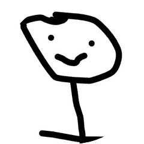</a>
  <a href="https://github.com/johndavid92" title="VishalKevadiya"></a>
  <a href="https://github.com/jonathanfristedt" title="Jonathan Fristedt"></a>
  <a href="https://github.com/josec-ecw" title="José Cano">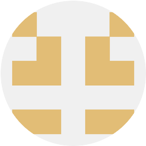</a>
  <a href="https://github.com/tgrushka" title="Tom Grushka"></a>
</p>

<p align="center">Thank you to everyone who has made this package better.</p>

## Contributing

Contributions are welcome! Please feel free to submit a Pull Request.

1. Fork the repository
2. Create your feature branch (`git checkout -b feature/amazing-feature`)
3. Commit your changes (`git commit -m 'Add amazing feature'`)
4. Push to the branch (`git push origin feature/amazing-feature`)
5. Open a Pull Request

## Credits

This package is based on:
- [cupertino_native_plus](https://pub.dev/packages/cupertino_native_plus) by NarekManukyan
- [cupertino_native](https://pub.dev/packages/cupertino_native) by Serverpod

## License

MIT License - see [LICENSE](LICENSE) for details.
